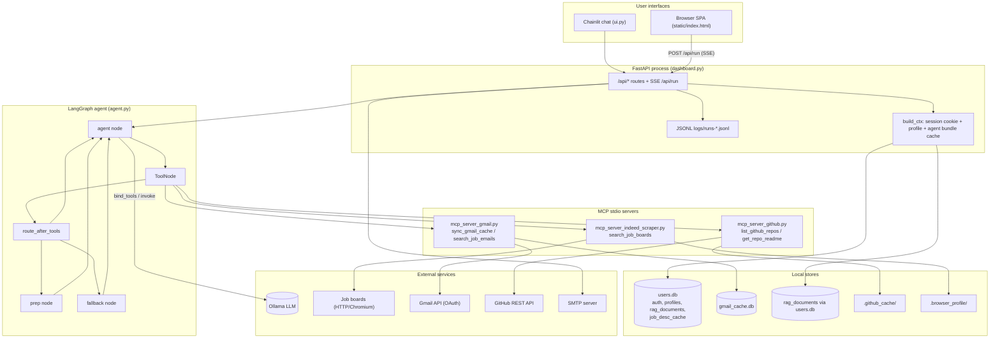
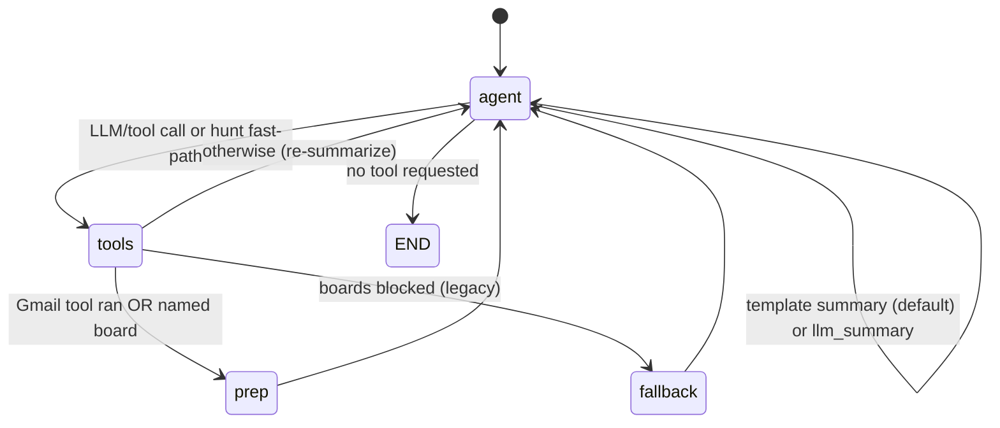
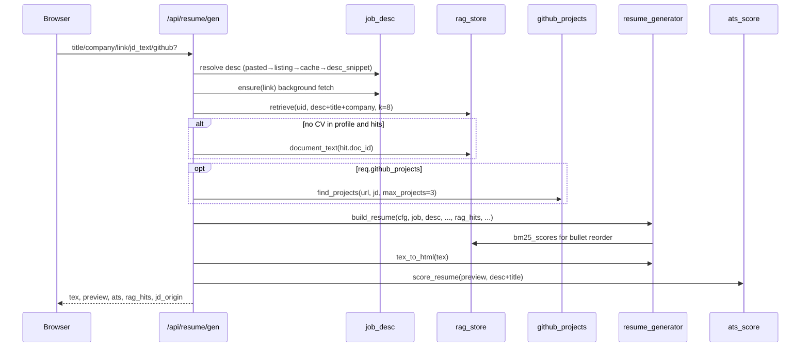
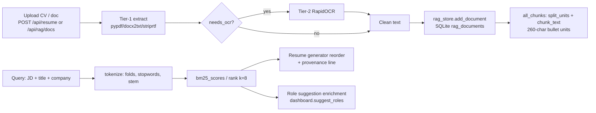

# JobScope — Complete Technical Documentation

> **Document type:** Combined technical reference (architecture, modules, API, RAG, operations).
> **Audience:** Software engineers, maintainers, contributors, technical reviewers.
> **Source of truth:** The Python/JS source in this repository. Every claim is tied to a real file and symbol; behaviors that could not be verified are labeled explicitly.
> **Companion files:** `README.md` (quick start), `docs/JobScope_Guide.tex` (user-facing LaTeX guide). Neither was modified when this document was produced.

---

## Table of Contents

1. [Executive Summary](#1-executive-summary)
2. [Introduction](#2-introduction)
3. [Technology Stack](#3-technology-stack)
4. [Project Architecture](#4-project-architecture)
5. [Project Directory Structure](#5-project-directory-structure)
6. [Installation and Environment Setup](#6-installation-and-environment-setup)
7. [Configuration Reference](#7-configuration-reference)
8. [Detailed Module Documentation](#8-detailed-module-documentation)
9. [End-to-End Workflows](#9-end-to-end-workflows)
10. [Database and Data Models](#10-database-and-data-models)
11. [API Documentation](#11-api-documentation)
12. [Algorithms and Core Concepts](#12-algorithms-and-core-concepts)
13. [Specialized RAG System Documentation](#13-specialized-rag-system-documentation)
14. [Error Handling and Troubleshooting](#14-error-handling-and-troubleshooting)
15. [Security Considerations](#15-security-considerations)
16. [Testing and Quality Assurance](#16-testing-and-quality-assurance)
17. [Performance and Scalability](#17-performance-and-scalability)
18. [Deployment and Operations](#18-deployment-and-operations)
19. [Limitations and Future Improvements](#19-limitations-and-future-improvements)
20. [Glossary](#20-glossary)
21. [References](#21-references)
22. [Documentation Coverage Summary](#22-documentation-coverage-summary)

---

# 1. Executive Summary

## 1.1 Project overview

**JobScope** is a locally run, AI-assisted job-hunting platform for technical candidates. It searches multiple job boards in parallel, falls back to Gmail job-alert emails when boards are blocked, ranks the candidate's own documents with BM25 to tailor an ATS-friendly LaTeX resume, scores that resume against a job description, and presents everything through a streaming dashboard (plus an optional Chainlit chat UI).

All LLM inference runs locally through **Ollama**. No hosted model API is required.

## 1.2 Primary objectives

| Objective | How the system addresses it |
|---|---|
| Automate multi-board job discovery | `search_job_boards` MCP tool fans out across 9 boards with a hard 40 s deadline |
| Survive bot walls / 403s | Two-tier fetching (TLS impersonation → Chromium), failure caching, optional human-in-the-loop solving, Gmail fallback as a deterministic graph edge |
| Produce honest, tailored resumes | Content pipeline may only reorder/emit text the candidate uploaded (enforced in `resume_generator.py` and `rag_store.py`) |
| Keep everything local and free | Ollama LLMs, SQLite stores, CPU-only OCR (RapidOCR/ONNX), no cloud DB |
| Explainable retrieval | Okapi BM25 with an explicit anti-hallucination rule: retrieval returns stored substrings only |

## 1.3 Problems addressed

1. **Board scraping fragility** — CAPTCHAs, TLS fingerprinting, and JS shells cause hard failures; sequential "try boards, then email" designs waste minutes on local CPUs.
2. **LLM nondeterminism in control flow** — trusting the model to follow prose instructions like "if blocked, use Gmail" fails in practice; JobScope encodes that decision as graph edges and regex routers.
3. **Resume hallucination** — LLM-written bullets that assert skills the candidate never had; JobScope's generator never invents skills, bullets, links, or sections.
4. **Repeat results** — every hunt returning the same top cards; per-account "already seen" memory (`seen_scope="u{user_id}"`) with LRU-bounded buckets.
5. **Paid API dependency** — replaced Anthropic/OpenAI with Ollama (see `requirements.txt:6-9`).

## 1.4 Target audience

- Engineers extending or maintaining the agent, scraper, or resume pipeline
- Candidates running JobScope locally for their own job search
- Technical reviewers evaluating the RAG/retrieval and anti-hallucination design
- Students learning LangGraph + MCP agent architectures

## 1.5 Key capabilities

- Multi-board search (Indeed, LinkedIn, Naukri, Glassdoor, Foundit, Internshala, WeWorkRemotely, Remotive, Arbeitnow)
- Deterministic boards→Gmail fallback and source selection (`agent.py` graph)
- Shared filter rules in code (`filters.py`) used by both scraper and agent
- Gmail job-alert indexing via Gmail API (OAuth), local SQLite cache, sender-diversified retrieval
- Per-user RAG document library with Okapi BM25 retrieval (no embeddings)
- LaTeX resume generation + in-process HTML preview + ATS scoring (0–100)
- PDF/DOCX/RTF extraction with a second-tier OCR path (PyMuPDF + RapidOCR)
- Multi-profile accounts, email verification, password reset, idle session timeout
- SSE-streaming dashboard with flashcard job deck; machine-to-machine `POST /api/screen` for n8n
- JSONL run/error logging; manual browser bot-wall solving

## 1.6 Major limitations (confirmed in code)

- BM25-only retrieval (no embeddings, no vector DB, no reranker, no hybrid fusion)
- English-oriented tokenization/stemming only (`rag_store.py:64-83`)
- No server-side LaTeX compilation — the server returns `.tex` + HTML; the user compiles (Overleaf/pdflatex)
- Gmail transport is OAuth/Gmail API only (no live IMAP path remains in runtime code)
- `mcp_server_gmail_oauth_fixed.py` does not compile (literal `\n` at line 262) and is referenced by nothing
- npm dependency `llama-ocr` is declared but never invoked
- Several vendored third-party trees (`Scrapling-main`, `crawl4ai-main`, `laya-main`) are present for reference/install; only Scrapling is imported by the app

---

# 2. Introduction

## 2.1 Background and motivation

Job hunting for early-career engineers is a high-volume, high-noise activity: listings are duplicated across boards, alert emails are inconsistent, and resume tailoring either costs money (ATS tools) or risks fabrication (unconstrained LLM generation). The project README and module docstrings frame the design around two non-negotiables:

1. **Determinism where it matters** — routing, filtering, ranking, and content selection live in code.
2. **Honesty over fluency** — a generated resume must never assert something the candidate did not write (`rag_store.py:11-19`, `resume_generator.py` module rules).

## 2.2 Problem statement

Given:

- a target role and optional skill keywords from an uploaded CV,
- user-selected geography/work-mode filters,
- access to job boards and a Gmail inbox of job alerts,

produce: a filtered, deduplicated, non-repetitive deck of real application links; an optional ATS-scored, job-tailored LaTeX resume assembled only from the candidate's own content; and a transparent record of what happened (tools, timings, blocked boards).

## 2.3 Project goals

- Sub-second decision paths for hunt initiation (skip the LLM tool-selection round-trip on local CPUs)
- ≤40 s hard cap on a board sweep (`GLOBAL_DEADLINE`, `mcp_server_indeed_scraper.py:201`)
- Every listed job carries a full `https://` application link
- Explainable resume tailoring (BM25 scores + provenance line listing source document names)

## 2.4 Scope

**In scope:** local single-machine deployment; personal-use multi-account auth; board scraping with ethical human-verify opt-in; Gmail alert mining; resume generation/scoring; optional n8n webhook screening.

**Out of scope (not implemented):** automatic job application submission (no `/api/apply` endpoint exists — apply links open in the browser); hosted multi-tenant SaaS hardening; outbound digest emails; multi-language NLP; embedding-based semantic search.

## 2.5 Functional requirements (as implemented)

| # | Requirement | Evidence |
|---|---|---|
| FR1 | User can register, verify email (or auto-verify if SMTP unset), log in, reset password | `dashboard.py:1612-1881`, `auth.py`, `mailer.py` |
| FR2 | User can upload a CV; system extracts text, skills, roles, location, links | `POST /api/resume` (`dashboard.py:2369-2483`) |
| FR3 | User can store additional documents in a per-user RAG library | `POST/GET/DELETE /api/rag/docs` |
| FR4 | Hunt request streams board (or Gmail) results as SSE events ending in a flashcard deck | `POST /api/run` → `_run_stream` |
| FR5 | When boards are blocked, agent falls back to Gmail alerts deterministically | `route_after_tools` + `fallback_node` (`agent.py:944-1072`) |
| FR6 | User can generate a tailored LaTeX resume + HTML preview + ATS score | `POST /api/resume/gen` |
| FR7 | Machine-to-machine resume screening via shared token | `POST /api/screen` |
| FR8 | Profiles (multiple CVs/settings) per account, persisted in SQLite | `auth.py` profiles API + dashboard profile routes |
| FR9 | Runs and errors logged as daily JSONL | `logs/runs-YYYYMMDD.jsonl`, `logs/errors-YYYYMMDD.jsonl` |

## 2.6 Non-functional requirements (observed design targets)

- **Local-first:** no mandatory cloud services; Ollama + SQLite + filesystem
- **Latency:** summary step defaults to instant template mode (`AGENT_SUMMARY_MODE=template`) to avoid 2–4 min CPU LLM inference (`agent.py:323-327`)
- **Privacy:** sensitive stores git-ignored (`.gitignore:2-3,47-70`); tests redirected off real DBs (`conftest.py:25-37`)
- **Explainability:** BM25 scores, JOBS_JSON payloads, per-board block reasons, ATS breakdown

## 2.7 Assumptions and constraints

- Candidate runs the software on their own machine (Windows paths observed in this checkout; code is OS-portable except display detection for manual verify)
- Ollama is installed and a model (default `llama3.1`) is pulled; not a pip package
- Gmail access requires a Google Cloud OAuth client (`client_secret.json`) and a one-time `gmail_login.py` bootstrap
- Board scraping is best-effort; boards change markup without notice
- `Scrapling-main/` must be vendored and installed editable (`requirements.txt:49-60`) for the fast HTTP path

---

# 3. Technology Stack

| Technology | What it is | Why used here | Responsibilities | Interactions / config |
|---|---|---|---|---|
| **Python 3.11+** (3.14 observed in `__pycache__`) | Runtime | Ubiquitous ML/web ecosystem; stdlib SQLite/imap-era tooling | Entire backend | `.venv` recommended |
| **LangGraph 1.2.11** | Agent state-machine library | Deterministic graph edges for fallback/routing beyond pure chains | `StateGraph` with nodes `agent`, `tools`, `prep`, `fallback` (`agent.py:1074-1093`) | Consumes LangChain messages |
| **langchain-core / langchain-ollama** | Message types + Ollama chat wrapper | Standard `AIMessage`/`ToolMessage` shapes; local LLM | `ChatOllama(model, num_ctx).bind_tools(...)` (`agent.py:861-865`) | Talks to local Ollama HTTP API (`OLLAMA_URL`) |
| **MCP 1.30 + langchain-mcp-adapters 0.3.2** | Model Context Protocol clients | Tool discovery from stdio subprocesses | `MultiServerMCPClient` launching 3 servers (`agent.py:759-787`) | stdio; env forwarded explicitly (not inherited) |
| **Ollama** | Local LLM server | Free, private inference | Job summarization / optional chat answers | `OLLAMA_MODEL`, `OLLAMA_NUM_CTX` |
| **FastAPI 0.116 + uvicorn 0.53** | Async HTTP framework | SSE streaming, DI via `Depends` | All `/api/*` routes + static hosting (`dashboard.py:1496-1497`) | Session cookie auth per route |
| **Chainlit 2.8** | Chat UI framework | Streaming token UI with tool steps | `ui.py` | Calls `create_agent()` on chat start |
| **Scrapling (vendored 0.4.x + fetchers)** | Anti-bot HTTP/browser scraping | curl_cffi TLS impersonation + patchright Chromium | `boards.fetch` / `boards.scrape` (`boards.py:148-194, 625-650`) | Optional; legacy regex scrapers as fallback |
| **SQLite (stdlib)** | Embedded DB | Zero-ops persistence | `users.db` (auth/profiles/RAG/job_desc_cache), `gmail_cache.db` | `auth.connect()`, WAL for gmail cache |
| **pypdf / docx2txt / striprtf** | Document text extraction | Tier-1 CV/RAG ingestion | `dashboard._extract_text` (`dashboard.py:1181-1225`) | Before OCR tier |
| **PyMuPDF + RapidOCR + onnxruntime** | CPU OCR | Scanned PDFs/images without text layer | `cv_ocr.ocr_document` | Tier-2, gated by `needs_ocr` |
| **Google Gmail API (google-auth flow)** | Official mail API | Reliable alert-mail access without IMAP app-password fragility in the active path | `mcp_server_gmail.py` tools | OAuth token file `gmail_oauth_token.json` |
| **smtplib** | SMTP client | Verification/reset/welcome mail | `mailer.send` | `SMTP_*` env |
| **pytest 8+ / pyflakes** | Test & lint tooling | Regression safety | `tests/` | `pytest.ini` `testpaths=tests` |
| **n8n** (external) + `n8n/import.py` | Workflow automation | Optional resume-screening pipeline | Posts resumes to `POST /api/screen` | `SCREEN_TOKEN` header |

**Alternatives and trade-offs (as argued in-repo):**

- **BM25 over embeddings** (`rag_store.py:21-27`): corpus is one-to-a-few documents (~hundreds of chunks); BM25 needs no model download, works on Python 3.14 without torch, and every score is explainable. Embeddings deferred to library-scale corpora.
- **Deterministic routing over prompt instructions** (`agent.py:12-16`): the #1 failure mode of the prior design was the LLM misreading prose fallback instructions.
- **Template summary over LLM summary** (`agent.py:199-201, 323-327`): instant, zero-token path; LLM remains opt-in via `AGENT_SUMMARY_MODE=llm`.
- **RapidOCR over VLM OCR** (`cv_ocr.py:15-25`): VLMs confidently invent emails/phone numbers; measured OCR CER ~3.15% at 99.5% confidence at 150 dpi.

---

# 4. Project Architecture

## 4.1 Overall architecture

JobScope is a **single-process FastAPI application** (plus optional Chainlit process) that embeds a **LangGraph agent** and spawns **three MCP tool servers as stdio subprocesses**. Persistence is file/SQLite-based. There is no external message bus or microservice split.



## 4.2 Major components and responsibilities

| Component | File(s) | Responsibility |
|---|---|---|
| Agent core | `agent.py` | Config, MCP runtime, LangGraph wiring, deterministic collect/prep/fallback, template vs LLM summary |
| Dashboard | `dashboard.py`, `static/index.html` | HTTP API, SSE hunt streaming, resume/RAG/ATS endpoints, profile UI backend |
| Chat UI | `ui.py`, `.chainlit/` | Alternate streaming interface |
| Board layer | `boards.py`, `mcp_server_indeed_scraper.py` | Fetch/parse/parallelize/filter/rank board results; seen-memory |
| Shared rules | `filters.py` | Seniority, India-tied, work modes, regions, countries, sender lists, role synonyms, `JOBS_MARKER` |
| Gmail | `mcp_server_gmail.py`, `gmail_index.py`, `gmail_login.py` | OAuth sync, alert parsing, cache search |
| Resume | `resume_generator.py`, `resume_data.py` | CV parse, BM25 reorder, LaTeX emit, HTML preview |
| RAG | `rag_store.py` | Document store + BM25 rank |
| OCR | `cv_ocr.py` | Tier-2 scanned document recovery |
| ATS | `ats_score.py` | 0–100 structural/keyword/evidence score |
| Auth | `auth.py`, `mailer.py` | Users, sessions, tokens, profiles; SMTP mail |
| JD fetch | `job_desc.py` | Background full-description fetch + cache |
| GitHub projects | `github_projects.py` | Repo scoring + README-backed bullets |
| Manual wall | `manual_verify.py` | Human-solved CAPTCHA in a visible browser |
| Automation | `n8n/` | Optional screening workflow import |

## 4.3 LangGraph state machine

Nodes (`agent.py:1074-1093`):

| Node | Kind | Role |
|---|---|---|
| `agent` | `agent_node` | Hunt fast-path (no LLM) emits one tool call; otherwise LLM or template summary |
| `tools` | `ToolNode(tools)` | Executes the MCP tool the agent requested |
| `prep` | `prep_node` | Post-collect selection: boards if kept jobs else Gmail; drops bulky messages |
| `fallback` | `fallback_node` | Legacy path: boards blocked → single Gmail cache query |

Edges:

- `START → agent`
- `agent --tools_condition--> tools | END`
- `tools --route_after_tools--> agent | fallback | prep`
- `fallback → agent`, `prep → agent`



Key routers:

- `route_after_tools` (`agent.py:944-962`): if `fallback_used` → `agent`; if last tool was Gmail → `prep`; if user named a board → `prep`; else `fallback` if `_scrape_blocked` else `agent`.
- `requested_source` (`agent.py:830-846`): `GMAIL_SOURCE` regex vs the user's latest human message → `"gmail"` or `"boards"`.
- `requested_board` (`agent.py:804-815`): `detect_board` on human text → single-board restriction.

## 4.4 Data flow (hunt)

1. Browser `POST /api/run {message}` → SSE generator `_run_stream` (`dashboard.py:2860-2992`).
2. Payload seeded with `system_message(cfg)` + `HumanMessage` (`dashboard.py:2875-2876`).
3. `agent_node` sees no tool messages + hunt hint → `_collect_message` emits **one** tool call (`search_job_boards` or `search_job_emails`) with zero LLM inference (`agent.py:867-917`).
4. `ToolNode` runs the MCP subprocess tool; output includes prose + `###JOBS_JSON###` JSON (`filters.py:44`).
5. `route_after_tools` → `prep` (or `fallback` on legacy block).
6. `prep_node` parses both sources' JOBS_JSON, applies `filters.keep_job`, picks winner, deletes bulky `ToolMessage`s, appends compact `HumanMessage` payload (`agent.py:964-1025`).
7. `agent_node` builds `_template_summary` (default) or `llm_summary.invoke`.
8. Dashboard SSE streamer also watches tool outputs / prep payloads for `JOBS_MARKER` and emits `jobs` events for the flashcard deck (`dashboard.py:2939-2966`).

## 4.5 External dependencies

- Job board websites (unstable HTML)
- Gmail API (quota; retried on 403/429)
- GitHub REST API (60 req/h anon, 5000 with token)
- Ollama HTTP endpoint
- Optional SMTP

## 4.6 Architectural decisions and trade-offs

| Decision | Benefit | Cost |
|---|---|---|
| One process, SQLite | Simple ops, privacy | No horizontal scale; single-writer contention |
| MCP stdio subprocesses | Isolation, env control, tool auto-discovery | ~3.4 s startup (`MCPRuntime` docstring `agent.py:721-727`); secrets must be forwarded explicitly |
| Marker-based structured side-channel (`###JOBS_JSON###`) | LLM sees prose; code sees JSON | Fragile if tool output truncated before marker |
| Per-route auth dependency | No global middleware surprises | Every new route must remember `Depends(Ctx)` |
| Client-side LaTeX compile | Server needs no TeX distribution | User must have Overleaf/pdflatex |

---

# 5. Project Directory Structure

```
jobscope/
├── agent.py                     # LangGraph agent: config, MCP runtime, graph nodes/routers
├── dashboard.py                 # FastAPI app: 35 routes, SSE hunt stream, helpers
├── ui.py                        # Chainlit chat UI over the same agent
├── filters.py                   # Shared listing rules, senders, synonyms, JOBS_MARKER
├── boards.py                    # Scrapling fetch + 7 CSS board parsers + BoardSpecs
├── mcp_server_indeed_scraper.py # MCP tool search_job_boards (9 boards, sweep, seen-memory)
├── mcp_server_gmail.py          # MCP tools sync_gmail_cache, search_job_emails (Gmail API OAuth)
├── mcp_server_gmail_oauth_fixed.py  # DEAD: SyntaxError line 262; not imported anywhere
├── mcp_server_github.py         # MCP tools list_github_repos, get_repo_readme
├── gmail_index.py               # gmail_cache.db schema, search, diverse_listings
├── gmail_login.py               # One-time OAuth bootstrap → gmail_oauth_token.json
├── rag_store.py                 # Per-user document library + Okapi BM25
├── resume_generator.py          # CV parse, BM25 reorder, ATS LaTeX template, HTML preview
├── resume_data.py               # Canonical placeholder CV content (fallback person)
├── ats_score.py                 # 0–100 ATS score (contact/sections/structure/dates/keywords/evidence)
├── cv_ocr.py                    # Tier-2 OCR (PyMuPDF + RapidOCR/ONNX)
├── auth.py                      # users.db schema, scrypt auth, sessions, tokens, profiles
├── mailer.py                    # SMTP verification / reset / welcome mail
├── job_desc.py                  # Background JD fetch (2-tier) + job_desc_cache
├── github_projects.py           # JD-matched GitHub projects with README evidence guard
├── manual_verify.py             # Human bot-wall solving in visible Chromium
├── mcp_server_gmail*.py         # (see above)
├── conftest.py                  # Test isolation: redirects users.db / profiles.json
├── pytest.ini                   # testpaths=tests; slow marker; excludes vendored trees
├── requirements.txt             # Runtime deps incl. editable Scrapling
├── requirements-dev.txt         # pytest + pyflakes
├── package.json                 # Declares unused npm dep llama-ocr
├── client_secret.json           # Google OAuth client (git-ignored)
├── gmail_oauth_token.json       # User OAuth token (git-ignored)
├── users.db                     # Live SQLite (git-ignored; do not commit)
├── gmail_cache.db               # Live alert-mail cache (git-ignored)
├── profiles.json                # Legacy profile store (migrated into SQLite)
├── step1_basics.py … step7_scraper_with_fallback.py  # Tutorial progression
├── tests/                       # pytest suite + verify_boards_verdict replay harness
├── static/                      # index.html (inline CSS/JS), SVGs, favicon
├── docs/                        # JobScope_Guide.tex + this document
├── n8n/                         # import.py, README.md, workflows/resume-screening.json
├── logs/                        # runs-YYYYMMDD.jsonl, errors-YYYYMMDD.jsonl
├── .chainlit/                   # Chainlit config.toml
├── .github_cache/               # Cached GitHub READMEs with TTL
├── .browser_profile/            # Persistent Chromium profile for manual verify
├── Scrapling-main/              # Vendored Scrapling source (pip install -e)
├── crawl4ai-main/               # Reference checkout (not imported)
├── laya-main/                   # Reference checkout (not imported)
└── node_modules/                # JS tooling (syntax-check only)
```

Relationships worth knowing:

- `agent.py` imports `filters` and launches the three MCP servers; nothing else may import `agent` at module import time in tests without Ollama/MCP available (tests target pure helpers).
- `dashboard.py` is the composition root: auth, agent bundles, resume, RAG, ATS, gmail sync, logs.
- `filters.py` is the **single source of truth** for listing rules consumed by both `agent._keep_job` and the scraper's `_apply_filters` — they cannot drift.
- `resume_generator` depends on `rag_store` (BM25 internals `_Doc`, `bm25_scores`, `tokenize`) and `filters` (city/country heuristics).
- `job_desc` reuses `boards.fetch` and imports `_clean_desc` from the Gmail MCP server for HTML→text.

---

# 6. Installation and Environment Setup

## 6.1 Prerequisites

1. **Python 3.11+** (this checkout also runs on 3.14; torch-free by design)
2. **Ollama** installed from https://ollama.com (not pip), then:
   ```bash
   ollama pull llama3.1
   ```
3. **Git** and ability to vendor Scrapling:
   ```bash
   pip install -e "./Scrapling-main[fetchers]"
   python -m playwright install chromium
   ```
   (`requirements.txt:49-60` — the `[fetchers]` extra provides curl_cffi impersonation and the Chromium path.)
4. Optional: **Google Cloud OAuth client** for Gmail (`client_secret.json`)
5. Optional: **SMTP credentials** for verification emails
6. Optional: **GitHub token** (raises API rate limit 60 → 5000/h)
7. Optional: **LaTeX** (pdflatex) or an Overleaf account to compile generated `.tex`

## 6.2 Dependency installation

```bash
python -m venv .venv
# Windows:
.\.venv\Scripts\python.exe -m pip install -r requirements.txt
.\.venv\Scripts\python.exe -m pip install -r requirements-dev.txt
# Linux/macOS:
source .venv/bin/activate
pip install -r requirements.txt
pip install -r requirements-dev.txt
```

Notes:

- `requirements.txt` includes `-e ./Scrapling-main[fetchers]` — the vendored tree must exist first.
- OCR packages (`pymupdf`, `rapidocr`, `onnxruntime`) are optional at runtime: the app still handles text-layer PDFs without them (`requirements.txt:34-40`, `cv_ocr.available()`).
- `node_modules` / `llama-ocr` are **not required**; nothing in the Python app imports them.

## 6.3 Environment variables

Create `.env` in the project root (loaded via `python-dotenv` in `agent.py:47`, `mailer.py:39-41`, and other modules). **Never commit `.env`.** Use placeholders for secrets. See [§7 Configuration Reference](#7-configuration-reference) for the full table.

## 6.4 Gmail OAuth bootstrap (optional but required for alert fallback)

1. Create a Google Cloud project, enable Gmail API, create an OAuth Desktop client, download as `client_secret.json`.
2. Set `GMAIL_OAUTH_CREDENTIALS` (default file name `client_secret.json`) and optionally `GMAIL_OAUTH_TOKEN_FILE` (default `gmail_oauth_token.json`).
3. Run once:
   ```bash
   python gmail_login.py
   ```
   This opens a browser, requests `https://www.googleapis.com/auth/gmail.readonly`, and writes the token file (`gmail_login.py:6-11`).
4. Configure `GMAIL_SENDERS` (and optional `_2`/`_3` accounts) so sync knows which alert senders to index (`filters.FALLBACK_SENDERS` used as default).

## 6.5 Database initialization

- `users.db` is created lazily: `auth.init_db()` runs on dashboard lifespan (`dashboard.py:1489`).
- `gmail_cache.db` is created by `gmail_index.init()` on first sync.
- No manual migration step; `auth._migrate()` adds newer columns (`nickname`, `avatar`, `last_seen`) via `ALTER TABLE` (`auth.py:180-195`).

## 6.6 Startup commands

| Purpose | Command | What it does |
|---|---|---|
| Dashboard (recommended) | `uvicorn dashboard:app --reload --port 8000` or `python dashboard.py` | FastAPI + SSE UI at http://127.0.0.1:8000 (`dashboard.py:3006-3086`, default `HOST=127.0.0.1`) |
| Chat UI | `chainlit run ui.py` | Chainlit app sharing the same agent/`.env` |
| CLI hunt | `python step7_scraper_with_fallback.py "Find Junior Python Developer jobs remote"` | One-shot agent run using `create_agent()` |
| Agent smoke test | `python agent.py` | Builds MCP runtime, lists tools, proves `reconfigure()` reuses tools |
| Tests | `pytest` (or `.\.venv\Scripts\python.exe -m pytest tests -q`) | Uses `pytest.ini` testpaths; skips vendored suites |
| OAuth bootstrap | `python gmail_login.py` | Writes Gmail OAuth token |
| n8n import | `python n8n/import.py --help` (see `n8n/README.md`) | Pushes workflow/credentials to n8n |

## 6.7 Verification steps

1. `python agent.py` — expect `[selfcheck] OK` and a tool list including `search_job_boards`, `search_job_emails`, `list_github_repos`, `get_repo_readme` (exact names verified in code; count may be 4+).
2. Open http://127.0.0.1:8000 — register (first account becomes owner), verify or auto-verify if SMTP unset (`dashboard.py:1650`).
3. Upload a PDF CV — expect skills, role suggestions, inferred location in the response/UI.
4. Send a hunt message — expect SSE `status` → `tool_start`/`tool_end` → `jobs` → `status done` frames.
5. Generate a resume for a listing — expect `.tex`, HTML preview, ATS JSON.
6. Check `logs/runs-*.jsonl` for `resume_generated` / `start`/`done` events.

---

# 7. Configuration Reference

All variables are environment/`.env` settings. Defaults are **code defaults** unless noted. Secret columns show placeholders only.

| Variable or Setting | Purpose | Required? | Default | Example |
|---|---|---|---|---|
| `OLLAMA_URL` | Ollama HTTP base URL (used by langchain-ollama) | No | library default (`http://localhost:11434` — library default, not re-declared in app code) | `http://127.0.0.1:11434` |
| `OLLAMA_MODEL` | Chat model name | No | `llama3.1` (`agent.py:211`) | `llama3.1` |
| `OLLAMA_NUM_CTX` | Context window tokens | No | `8192` (`agent.py:212`) | `8192` |
| `TARGET_ROLE` | Default target role string | No | `Junior Data Analyst / entry-level, 0-2 years experience` | `Backend Engineer / entry-level` |
| `AGENT_SUMMARY_MODE` | `template` (instant code summary) or `llm` | No | `template` (`agent.py:219`) | `template` |
| `RESUME_EXTRACT_MODE` | Skill extraction mode used by dashboard helper | No | deterministic default in code | (see `dashboard.extract_skills`) |
| `JOB_DAYS_BACK` | Lookback window for hunts/Gmail | No | `60` (`agent.py:217`) | `30` |
| `JOB_MAX_RESULTS` | Max results requested from tools | No | `10` (`agent.py:218`) | `15` |
| `INDEED_API_KEY` | Present in `.env` template; not consumed by the documented scraper path | No | — | `***` |
| `GITHUB_TOKEN` | Optional GitHub API token (rate limit) | No | unset | `ghp_***` |
| `GITHUB_USERNAME` | Legacy/tutorial username (agent uses CV-derived handle) | No | — | `yourhandle` |
| `GMAIL_ADDRESS` / `GMAIL_APP_PASSWORD` | Legacy IMAP pair in `.env`; **active Gmail path is OAuth** | Legacy | — | `you@gmail.com` / `***` |
| `GMAIL_SENDERS` | Comma-separated alert senders for account 1 | No | `filters.FALLBACK_SENDERS` | `donotreply@jobalert.indeed.com,jobs-noreply@linkedin.com` |
| `GMAIL_ADDRESS_2` / `GMAIL_APP_PASSWORD_2` / `GMAIL_SENDERS_2` | Second mailbox (same pattern; `_3` also supported in `GMAIL_ACCOUNT_VARS`) | No | — | — |
| `GMAIL_OAUTH_CREDENTIALS` | Path to OAuth client secrets JSON | For Gmail sync | `client_secret.json` | `client_secret.json` |
| `GMAIL_OAUTH_TOKEN_FILE` | Path to saved user token | For Gmail sync | `gmail_oauth_token.json` | `gmail_oauth_token.json` |
| `GMAIL_CACHE_DB` | Override path of `gmail_cache.db` | No | `gmail_cache.db` beside module (`gmail_index.py:119-120`) | `/data/gmail_cache.db` |
| `SMTP_HOST` | SMTP server host for auth mail | For sending mail | unset (mail disabled) | `smtp.example.com` |
| `SMTP_PORT` | SMTP port | No | `587` (`mailer.py:80`) | `465` (implicit TLS) |
| `SMTP_USER` | SMTP username | For auth mail | unset | `***` |
| `SMTP_PASSWORD` | SMTP password | For auth mail | unset | `***` |
| `SMTP_FROM` | From address | No | falls back to `SMTP_USER`, then `no-reply@localhost` | `no-reply@example.com` |
| `SMTP_TLS` | STARTTLS on/off | No | on; `0/false/no` disables | `1` |
| `SMTP_TIMEOUT` | SMTP timeout seconds | No | `15` | `30` |
| `HOST` | Bind host for `python dashboard.py` | No | `127.0.0.1` | `0.0.0.0` |
| `APP_URL` | Public base URL (verification links) | Recommended with SMTP | (not fully traced in this doc — verify usage before relying) | `https://jobscope.example.com` |
| `AUTH_DEV_LINKS` | Return dev links for verify/reset instead of only emailing | No | off; truthy `1/true/yes/on` (`mailer.dev_links_allowed`) | `on` (dev only) |
| `SCREEN_TOKEN` | Shared secret for `POST /api/screen` | For n8n screening | unset → endpoint returns 503 | `***` |
| `N8N_API_KEY` / `N8N_URL` | Used by `n8n/import.py` CLI | For import | — | `***` / `http://localhost:5678` |
| `N8N_OLLAMA_BASE_URL` | Ollama URL recorded in n8n credential import | No | — | `http://host.docker.internal:11434` |
| `JOBSCOPE_MANUAL_WALL` | `auto` \| `on` \| `off` human bot-wall mode | No | `auto` (`manual_verify.py:32`) | `on` |
| `JOBSCOPE_MANUAL_SECONDS` | Human solve window | No | `240` (clamped 30–1800) | `300` |
| `JOBSCOPE_MANUAL_PROFILE` | Chromium user-data dir | No | `.browser_profile` | `.browser_profile` |
| `JOBSCOPE_OCR` | `auto` \| `on` \| `off` | No | `auto` (`cv_ocr.py:31`) | `auto` |
| `JOBSCOPE_OCR_MAX_PAGES` | OCR page cap | No | `4` (1–25) | `8` |
| `JOBSCOPE_OCR_DPI` | Render DPI | No | `150` (72–400) | `200` |
| `JOBSCOPE_OCR_SECONDS` | OCR time budget | No | `45` (5–600) | `90` |
| `JOBSCOPE_OCR_MIN_CONF` | Drop OCR lines below confidence | No | `0.55` (0–1) | `0.4` |
| `GITHUB_CACHE_DIR` | README cache directory | No | `.github_cache` | `.github_cache` |

---

# 8. Detailed Module Documentation

## 8.1 `agent.py` — orchestration core (1141 lines)

**Purpose.** Single source of truth for LangGraph wiring shared by CLI (`step7`), Chainlit (`ui.py`), and the dashboard.

**Important symbols.**

| Symbol | Line | Notes |
|---|---|---|
| `BLOCKED_MARKERS` | 53-62 | Substring markers treated as "boards blocked" |
| `TYPO_FIXES` | 69-89 | CV typo corrections for board queries |
| `HUNT_HINT` / `is_hunt_request` | 118-131 | Fast-path trigger |
| `SYSTEM_PROMPT` | 133-149 | Geo neutrality + markdown list rules |
| `AgentConfig` | 152-205 | All session knobs incl. `summary_mode`, `seen_scope`, `work_modes`, `countries` |
| `load_config` | 208-220 | `.env` → `AgentConfig` |
| `AgentState(MessagesState)` | 223-226 | Adds `fallback_used: bool` |
| `_text_content` | 229-249 | Normalizes MCP list-of-blocks content |
| `_scrape_blocked` | 252-262 | Last tool was scraper AND marker hit |
| `_summary_payload` / `_link_block` | 280-304 | Compact note + JOBS_JSON for summary LLM |
| `_drop_bulky` | 307-320 | RemoveMessage for ToolMessages |
| `_template_summary` | 323-353 | Deterministic markdown summary |
| `_keep_job` | 356-369 | Delegates to `filters.keep_job` |
| `_extract_struct_from` / `_iter_payloads` | 372-389 | Parse `###JOBS_JSON###` |
| `_blocked_marker` | 392-417 | Payload `blocked` list first, prose markers fallback |
| `_fallback_note` / `_fallback_node_note` | 436-486 | Never announce absent fallback data |
| `board_tool_args` | 529-559 | Pure config → tool args mapping |
| `_board_role_phrase` | 579-640 | Strip qualifiers/bracket asides; typo-fix |
| `search_query_from` | 643-683 | Primary role + ≤2 distinctive skills |
| `system_message` | 498-526 | Injects skills, modes, countries, roles |
| `MCPRuntime` / `create_runtime` | 720-787 | One-shot tool discovery; env forwarding rules |
| `requested_board` / `requested_source` | 804-846 | User-intent routers |
| `create_agent` | 849-1095 | Builds LLM bindings + compiled graph |
| `AgentBundle` | 1098-1115 | `(app, runtime, cfg)` with `reconfigure()` |

**Inputs/outputs.** `create_agent(cfg, runtime)` → `AgentBundle`; graph invoked with `astream` message lists. Tools return text possibly containing `###JOBS_JSON###`.

**Execution sequence (fresh hunt).** `agent_node` → `_collect_message` (no LLM) → `tools` → `route_after_tools` → `prep` → `agent_node` (template summary).

**Error handling.** Missing MCP server → `RuntimeError` from `_find_tool` caught in collect paths (`agent.py:906-916`); Gmail timeout wrapped `asyncio.wait_for(..., 120)` (`agent.py:1038-1054`).

**Known limitations.** Region chips are retired but remain on `AgentConfig` for old profiles (`agent.py:179-182`); `remote_only` is legacy-off everywhere.

## 8.2 `filters.py` — shared listing rules (1223 lines)

**Purpose.** Pure, side-effect-free rules so the scraper and the agent cannot disagree.

**Public surface (selected).** `JOBS_MARKER` (44); Gmail sender constants and `FALLBACK_SENDERS` (52-71); `GMAIL_ACCOUNT_VARS`/`gmail_accounts`/`gmail_senders_for_account`/`gmail_search_plan` (99-149); `BOARD_ALIASES` (167); `ROLE_SYNONYMS`/`role_synonyms_for`/`related_roles`/`synonym_words` (192-296); `SENIORITY_FILTER`/`EXPERIENCE_FILTER` (320-337); `WORK_FROM_HOME`/`INDIA_SCOPED_REMOTE` (340-350); `detect_board`/`canonical_board` (353-385); `is_senior_or_experienced` (394); `keep_job` (438-467); `WORK_MODES`/`listing_work_modes`/`matches_work_mode`/`boards_location` (478-586); `CITY_OPTIONS`/`city_region`/`normalize_cities` (607-812); `REGIONS`/`identify_region`/`matches_region` (844-1026); `COUNTRIES`/`normalize_countries`/`identify_countries`/`matches_country` (1039-1216).

**`keep_job` pipeline order (452-467).** dict check → seniority(title+location) → India-tied (if `india_rule_applies`) → work modes → regions → countries → link must be http(s).

**Implementation decisions.** Company names are never seniority-scanned (false positives on "Senior Labs"); genuine WFH exempts the India rule; empty `work_modes=[]` means "don't filter" at the agent boundary (passed as `None`).

## 8.3 `boards.py` — fetch/parse layer (650 lines)

**Purpose.** Scrapling-backed HTTP/browser fetch + 7 CSS/XPath parsers.

| Symbol | Line | Notes |
|---|---|---|
| `BoardWall` / `ThrottledOrUnparsed` | 68 / 72 | Escalation exceptions |
| `Listing` dataclass | 81-95 | `source,title,company,location,salary,link` |
| `_WALL_MARKERS` / `_looks_walled` | 117-145 | Rendered-body heuristics |
| `fetch(...)` | 148-194 | `impersonate="chrome"` or StealthyFetcher |
| `parse_indeed` … `parse_weworkremotely` | 267-498 | Never raise on empty |
| `PARSERS` | 501-509 | name → parser |
| `BoardSpec` / `SPECS` | 512-589 | URLs, browser flags, `default_hunt` |
| `NOT_DEFAULT` / `is_default_board` | 618-622 | Glassdoor, Foundit, Naukri excluded from default sweep |
| `scrape` | 625-650 | One browser retry only |

**Measured behavior (module docstring table, 19-27):** Naukri and Foundit need Chromium; Glassdoor/Indeed/LinkedIn/Internshala/WWR clear HTTP impersonation.

## 8.4 `mcp_server_indeed_scraper.py` — board MCP server (1265 lines)

**Tool.** `search_job_boards(query, location="Remote", remote_only=True, board=None, work_modes=None, regions=None, countries=None, seen_scope="")` (`:898-904`).

**Constants.** `MAX_JOBS=20`, `MAX_FRESH_SCAN=200`, `SEEN_MEMORY=400`, `SEEN_SCOPES=16`, `BLOCK_CACHE_SECONDS=90`, `GLOBAL_DEADLINE=40.0`, `THIN_RESULT_COUNT=12` (`:59-206`).

**Board registry.** `BOARDS` (`:834-844`) holds 9 wrappers: Scrapling-first functions `_indeed`…`_weworkremotely` falling back to `*_legacy` regex scrapers when Scrapling is unavailable/empty (`_scrapling_collect` `:732-750`). Remotive and Arbeitnow are keyless JSON feeds handled only here (`_remotive` `:538`, `_arbeitnow` `:568`).

**Sweep.** `probe` per board (`:954-1007`); `sweep` uses `ThreadPoolExecutor(max_workers=len(hunt))` with hard deadline (`:1009-1061`); named board → sequential `force=True` probe (`:1067-1074`). Related-role widening if `< 12` results (`:1087-1108`).

**Seen-memory.** `seen_bucket` LRU of 16 scopes × 400 links (`:79-162`); `forget_scope` for account reset (`:144-162`).

**Output.** Prose lines + `\n\n###JOBS_JSON###\n` + JSON with keys `sources`, `source_detail`, `blocked`, `blocked_reasons`, `no_matches`, `boards_worked`, `widened_to`, `total`, `fresh`, `repeats`, `remote_only`, `work_modes`, `regions`, `countries`, `jobs` (`:1195-1235`). Each job dict: `source,title,company,location,salary,link` (+ `desc` only when non-empty; `Job.to_dict` `:267-275`).

## 8.5 `mcp_server_gmail.py` + `gmail_index.py`

**Transport.** Gmail API over OAuth 2.0 (docstring `mcp_server_gmail.py:1-8`). No `imaplib` in runtime paths.

**Tools.**

- `sync_gmail_cache(days_back=3650, account=0)` (`:590-639`): per account, query `from:"{sender}" after:{cutoff}`; fetch `format="raw"`; `parse_message`; `gmail_index.upsert_messages` + `record_sync`. Retries via `_api_call(tries=4)` with exponential backoff on 403/429 (`:567-587`).
- `search_job_emails(sender="", days_back=60, max_results=10, account=0, query="", resync_if_stale=True)` (`:642-681`): stale check (1 h TTL), over-fetch `max(max_results*6, 200)` per account, `diverse_listings` round-robin, emit JOBS_JSON.

**Parsing highlights.** `_best_job_link` ranking (`:120-168`); `_extract_listings` splits on "view job"/"apply" lines (`:352-413`); body capped 1200 chars (`parse_message` `:456-484`).

**`gmail_index.py` tables.** `mail_messages`, `mail_listings`, `mail_sync_state` (`:74-111`); `search_listings` ANDs query terms across title/company/location (`:234-267`); `diverse_listings` (`:270-304`).

**`mcp_server_gmail_oauth_fixed.py`.** Dead: literal `\n` syntax error at line 262; unreferenced. Do not use.

## 8.6 `mcp_server_github.py`

Tools: `list_github_repos(github_url_or_username)` (`:57-79`); `get_repo_readme(..., repo_name)` (`:82-99`). Token optional (`_gh_headers` `:36-43`). There is **no** `fetch_user_repos` tool.

## 8.7 `rag_store.py` — document library + BM25 (358 lines)

Full treatment in [§13](#13-specialized-rag-system-documentation). Core API: `tokenize` (86), `split_units`/`chunk_text` (131/161), `bm25_scores` (209), `rank` (260), `add_document`/`list_documents`/`delete_document`/`all_chunks`/`document_text`/`retrieve` (289-358).

## 8.8 `resume_generator.py` — tailoring pipeline (1504 lines)

**Pipeline (module docstring 5-16 + `build_resume` 791-1002).** `desc_snippet` (715) → `build_resume` → `tex_to_html` (1426). No TeX engine is invoked anywhere in the repo.

**CV parsing.** `CV_HEADINGS` (218-235): summary, skills, experience, projects, education, certifications, languages, activities. `parse_cv` (286-321) → `{contact, sections, links}`.

**BM25 usage.** `_relevance_scores` imports `rag_store._Doc/bm25_scores/tokenize` (441-459); `_reorder_bullets` stable-sorts bullets within entries only when `rag_hits` non-empty (462-514, called from `_assemble_from_cv` 1289-1299). Query = `f"{desc} {role}"` (1244).

**Skill ranking.** `_rank_skill_groups` (762-775) reorders the candidate's own groups using fixed `_POSTING_TERMS` (780-788); never adds skills. No-CV path `_rank_skills` (743-759) sorts `resume_data.SKILLS`.

**Template.** `ATS_TEMPLATE` (64-139): 10pt article, single column, `\section*`, no tables — ATS-friendly. Token fill at 985-1000. ASCII folding `_ascii_fold` (164-180).

**Never invented (enforced).** Skills absent from CV; bullet text; GitHub link; missing sections; entry chronology; locations (`resume_generator` rules cited in module comments 816-832, 863-871, 1221-1227).

**Objective.** Quote CV summary (1057-1065) or synthesize by copying CV phrases only (1068-1169). Not LLM-generated.

## 8.9 `resume_data.py`

Canonical placeholder person (name/phone/email/links at 16-25), `SKILLS` (39-59), `EXPERIENCE` (62-76), `PROJECTS` (79-97), education/certs/languages, `flat_skill_keywords()` (119-125). Used when no CV uploaded. Role suggestions live in `dashboard.ROLE_RUBRIC`/`suggest_roles` (116-565), not here.

## 8.10 `cv_ocr.py`

Tier-1 extraction is `dashboard._extract_text` (pypdf/docx2txt/striprtf/raw decode). Tier-2: `needs_ocr` (letters < 200, `:133-143`); `supported` PDF/images (`:110-113`); `ocr_document` (233-319) never raises; engine lazy singleton `_engine` (163-171). Config accessors 88-107.

## 8.11 `ats_score.py`

`score_resume(resume_text, jd_text="", sections=None)` (233-489). Weights: contact 12, sections 14, structure 16 (deduction model), dates 16, keywords 26 (`sqrt(coverage)*26`), evidence 16. Output: `{total, band, breakdown, issues, hits, missing, keyword_total}` (479-488). Accepts `.tex` or HTML via `_as_readable` (202-230).

## 8.12 `auth.py`

SQLite `users.db`. scrypt password hashing (`hash_password` 220-230; N=2^14, r=8, p=1, dklen=32). Sessions: `token_urlsafe(32)`, only SHA-256 stored (435-448); absolute 30-day expiry; idle 25 minutes with 5-minute extend (49-52, 475-523). One-time verify (24 h) / reset (2 h) tokens (585-616). Profiles CRUD (623-704). Full schema in [§10](#10-database-and-data-models).

## 8.13 `mailer.py`

`send` (107-149) never raises; returns `MailResult(ok, detail, dev_link)`. Port 465 → SMTP_SSL; else STARTTLS. Functions: `send_verification` (161), `send_password_reset` (171), `send_welcome` (180). **No outbound job digest exists.**

## 8.14 `job_desc.py`

`normalize_url` (111) → cache key; `extract` (148) selector chain with `DESC_MIN_CHARS=400`, `DESC_MAX_CHARS=6000`; `fetch_sync` (235) HTTP then browser (`network_idle=False`); `ensure` (283) 2-worker executor; `status_of` (215) `ready|empty|pending`. TTL 24 h (`DESC_TTL_SECONDS` 38).

## 8.15 `github_projects.py`

`find_projects(github_url_or_username, jd_text, max_projects=3, max_repos=40, max_readmes=6)` (429-485): list repos (drop forks/archived), score by shared JD terms (317-344), fetch READMEs (disk cache TTL 86400), `_bullet` refuses lines without README evidence (409-426). Rate-limit errors surface as `error` key; outages degrade, not fail.

## 8.16 `manual_verify.py`

Modes `auto|on|off` (`JOBSCOPE_MANUAL_WALL`). `start()` spawns daemon thread; visible StealthyFetcher with persistent profile; states `starting→waiting→done|blocked|failed` (335-363). Cleared check uses board parsers, not body length (161-185). Dashboard: `POST /api/verify-board` + poll GET.

## 8.17 `dashboard.py` (3086 lines) and `static/index.html`

Composition root; 35 routes documented in [§11](#11-api-documentation). Auth is per-route `Depends(build_ctx)` (1031-1052), not middleware. Bundle cache keyed `(uid, profile_id)` (988-1028). SSE streamer `_run_stream` (2860-2992). Frontend is a single HTML file with inline CSS/JS; consumes POST-body SSE via `fetch` + `getReader` (`index.html:2084-2142`).

## 8.18 Tutorial steps (`step1`–`step7`)

Progressive teaching artifacts, not production entry points: (1) pure LangGraph state; (2) tool-calling loop; (3) inline GitHub tool; (4) MCP client; (5) dual MCP servers / remote-OAuth discussion; (6) Gmail source (docstring still mentions IMAP — **historical**; production server is OAuth); (7) shared `agent.py` with deterministic fallback. Keep them as onboarding docs; do not treat step6's IMAP narrative as current architecture.

---

# 9. End-to-End Workflows

## 9.1 Workflow A — Job hunt (boards path, happy case)

**Trigger.** Authenticated user submits a chat message (e.g. "Find Junior Python roles remote") via the dashboard composer → `POST /api/run`.

1. `run()` (`dashboard.py:2995-3003`) allocates `run_id` (8 hex chars) and returns `StreamingResponse(_run_stream(...))`.
2. `_run_stream` emits `{type:"status", stage:"starting"}` (`:2866`), seeds `[system_message(cfg), HumanMessage(message)]` (`:2875-2876`), and calls `bundle.app.astream(..., stream_mode=["messages","updates"], recursion_limit=60)` (`:2886-2889`).
3. `agent_node` detects a hunt (`is_hunt_request`) with no prior tool messages → `_collect_message` emits **one** `search_job_boards` call built by `board_tool_args(cfg, human_text)` (query via `search_query_from`, location via `filters.boards_location`, optional `work_modes`/`countries`/`seen_scope`/`board`) — **no LLM inference**.
4. Dashboard may stream `tool_start` (`:2910-2911`).
5. `ToolNode` invokes MCP `search_job_boards` in the scraper subprocess:
   - determine boards (named board vs default sweep),
   - parallel `probe`s with 40 s deadline,
   - each probe: fetch (Scrapling) → parse → `_dedupe` → `_apply_filters` → seniority drop → `_select`,
   - rank globally, partition fresh vs seen for `seen_scope`, cap at 20, `_remember_seen`,
   - return prose + `###JOBS_JSON###` payload.
6. Dashboard `tool_end` (`:2927-2929`, output truncated 900 chars). If payload marker present, a `jobs` SSE event streams the deck (`:2939-2945`).
7. `route_after_tools`: last tool is boards, not blocked, no named-board special case → `agent` (legacy) or, when Gmail also ran / board named → `prep`. **Note:** in the current one-source design, boards-only runs typically return to `agent_node`, which applies `_template_summary` on the payload found in messages (`agent.py:931-941`).
8. Summary tokens stream as `token` events; final `status done`; `finally: _remember_run` appends a `done` JSONL row (`dashboard.py:2991-2992`, log schema in §10).

**Error path.** Board markers in `BLOCKED_MARKERS` → `route_after_tools` → `fallback` node → single `search_job_emails` over the Gmail cache → filtered deck or an honest "nothing came back" note (`agent.py:1027-1072`). SSE may emit `fallback` (`dashboard.py:2958-2959`).

## 9.2 Workflow B — Job hunt (explicit Gmail request)

**Trigger.** Message matches `GMAIL_SOURCE` regex (`agent.py:821-827`).

1. `_collect_message` emits `search_job_emails(sender="", days_back, max_results, account=0)` — one call covering all mailboxes.
2. MCP server checks staleness per account (`is_stale`, 3600 s), syncs if needed, searches cache, diversifies by sender, returns JOBS_JSON.
3. Router sees email tool → `prep_node` filters and summarizes.

## 9.3 Workflow C — CV upload → profile creation

**Trigger.** `POST /api/resume` multipart file ≤ 8 MB (`dashboard.py:2369-2483`).

1. `_extract_text` (tier-1). If `cv_ocr.needs_ocr` and `supported` → `_recover_text_by_ocr` in threadpool (tier-2).
2. `extract_skills` (deterministic default; `SKILL_CACHE` memoizes ≤32 texts).
3. `suggest_roles(skills, resume_text, rag_store.retrieve(uid, text, k=8))` → up to 4 roles (`ROLE_RUBRIC`).
4. `filters.identify_countries` / `infer_location`; `resume_generator.detect_links`-equivalent via dashboard `detect_links` (1055+).
5. `auth.create_profile` with the extracted `resume_text` and activate on session; response includes preview, skills, suggestions, inferred location, OCR flags.
6. Log event `resume_upload` to `logs/runs-*.jsonl`.

## 9.4 Workflow D — Tailored resume generation

**Trigger.** `POST /api/resume/gen` with job fields ± pasted JD (`dashboard.py:2585-2685`).



JD origin precedence: `pasted → listing (job_desc) → cache → link (desc_snippet ≤900 chars) → none` (`dashboard.py:2603-2626`). ATS score computed on the HTML preview (2669-2670). Response logged as `resume_generated`.

## 9.5 Workflow E — Registration → verification → login

1. `POST /api/auth/register` (min password 8) → `auth.create_user`; first account may adopt legacy `profiles.json` (`_migrate_legacy_profiles`); verification token + mail (or `mark_verified` if SMTP unconfigured); session cookie set.
2. User clicks emailed link → `GET /api/auth/verify?token=` → consume token, `mark_verified`, destroy other sessions, welcome mail.
3. `POST /api/auth/login` → scrypt verify (timing-equalized) → session cookie `js_session` HttpOnly SameSite=Lax; idle countdown via `/api/auth/session` + `/api/auth/extend`.

## 9.6 Workflow F — Machine screening (n8n)

1. n8n workflow (`n8n/workflows/resume-screening.json`) base64-encodes a resume and POSTs to `/api/screen` with header `X-JobScope-Token`.
2. Endpoint compares with `hmac.compare_digest` against `SCREEN_TOKEN` (503 if unset).
3. Extract (+ OCR fallback) → optional `job_desc.ensure` → `ats_score.score_resume` → JSON `{ok, ats, jd_origin, ...}`.
4. ATS score computed by code; the LLM (if any, inside n8n) only explains (`n8n/README.md`).

---

# 10. Database and Data Models

## 10.1 `users.db` (SQLite, stdlib `sqlite3`)

Path: next to `auth.py` (`DB_FILE`). Connection: `check_same_thread=False`, `timeout=10`, `Row` factory, `PRAGMA foreign_keys=ON` (`auth.py:168-177`).

```mermaid
erDiagram
    users ||--o{ sessions : "user_id"
    users ||--o{ email_tokens : "user_id"
    users ||--o{ profiles : "user_id"
    users ||--o{ rag_documents : "user_id"
    users ||--o{ job_desc_cache : "url (not user-scoped)"

    users {
        integer id PK
        text email UNIQUE
        text password_hash
        text created_at
        text verified_at
        integer is_owner
        text nickname
        text avatar
    }
    sessions {
        text token_hash PK
        integer user_id FK
        text created_at
        text expires_at
        text active_profile
        real last_seen
    }
    email_tokens {
        text token_hash PK
        integer user_id FK
        text purpose
        text created_at
        text expires_at
        text used_at
    }
    profiles {
        text id PK
        integer user_id PK_FK
        text name
        text created_at
        integer is_default
        text data
    }
    rag_documents {
        text id PK
        integer user_id PK_FK
        text name
        text kind
        text text
        text created_at
    }
    job_desc_cache {
        text url PK
        text text
        text source
        real fetched_at
    }
```

Notes:

- `profiles.data` is a JSON blob of the legacy `profiles.json` record shape (resume_text, skills, cities, roles, work_modes, countries, github_url, …).
- `rag_documents.text` holds full document text (≤ 400 000 chars enforced in `rag_store.add_document`).
- `job_desc_cache` is **deliberately not user-scoped** (`auth.py:159-164`).
- Column migrations: `_migrate` adds `users.nickname`, `users.avatar`, `sessions.last_seen` (`auth.py:180-195`).

## 10.2 `gmail_cache.db` (SQLite, WAL)

Path: `GMAIL_CACHE_DB` or `gmail_cache.db` beside `gmail_index.py`. Single writer lock (`gmail_index.py:116`).

| Table | Key | Purpose |
|---|---|---|
| `mail_messages` | `msg_id` PK | One row per alert message: account, sender, subject, sent_at, body ≤1200, listing_ct, synced_at |
| `mail_listings` | `(msg_id, ordinal)` PK | Parsed listings: title, company, location, link, sender, sent_at, account |
| `mail_sync_state` | `account` PK | last_sync, msg_count, last_error |

Indexes: `idx_mail_sender`, `idx_mail_sent`, `idx_mail_synced`, `idx_listing_sent` (`:86-103`). Nothing is deleted on re-sync except per-message listings replaced on upsert (`:176-186`).

## 10.3 JSONL logs

Daily files under `logs/`:

- `runs-YYYYMMDD.jsonl`
- `errors-YYYYMMDD.jsonl`

Observed event schemas (union of keys across files in this checkout):

| Event | Stream | Key fields |
|---|---|---|
| `owner_created` | runs | `email`, `profiles_adopted` |
| `login_failed` / `password_reset` | runs | `email` |
| `resume_upload` | runs | `user`, `file`, `chars`, `ocr`, `skills`, `suggested_role(s)`, `inferred`, `cities`, `links`, `profile` |
| `rag_doc_added` | runs | `user`, `doc`, `chars`, `ocr` |
| `resume_generated` | runs | `user`, `job`, `ats_score`, `jd_origin`, `rag_hits`, `github_*` |
| `start` / `done` | runs | `run`, `profile`, `model`, `duration_s`, `jobs`, `tools`, `status` |
| `config_updated` / `profile_loaded` / `reset` | runs | per-account state changes |
| `screen_resume` | runs | `file`, `ats_score`, `jd_chars` |
| `reset_email_failed` | errors | `detail` (e.g. SMTP not configured) |
| `skill_extractor_error` | errors | `detail` |

All records carry `event` and `ts` (`YYYY-MM-DDTHH:MM:SS`).

## 10.4 Other on-disk stores

| Store | Contents |
|---|---|
| `profiles.json` | Legacy multi-profile dict; migrated into SQLite on first register; re-homed on login if polluted |
| `.github_cache/*.json` | `{readme, at}` per repo, TTL 24 h |
| `.browser_profile/` | Chromium profile for manual verify sign-ins |
| `.chainlit/config.toml` | Chainlit session/timeout/upload settings |

**Backup:** copy `users.db`, `gmail_cache.db`, `profiles.json` (if still used), and `.env`. **Recovery:** SQLite files are self-contained; deleting `users.db` forces re-bootstrap (all accounts lost).

---

# 11. API Documentation

Base URL: dashboard origin (default `http://127.0.0.1:8000`). Auth: HttpOnly cookie `js_session` unless noted. JSON errors use `{ok:false, error|detail}` unless noted.

## 11.1 Authentication & account

| Method | Path | Auth | Purpose | Request → Response (shape) |
|---|---|---|---|---|
| GET | `/api/auth/state` | none | Bootstrap UI | → `{needs_bootstrap, authenticated, email, verified, smtp_configured, nickname, display_name, avatar, needs_nickname, seconds_left, idle_minutes, extend_minutes}` |
| POST | `/api/auth/register` | none | Create account | `{email,password}` → `{ok, verified, needs_verification, email, detail?, dev_link?, profiles_adopted}` + cookie |
| POST | `/api/auth/resend` | session | Resend verification | → `{ok,sent,detail,dev_link?}` |
| GET | `/api/auth/verify` | token query | Redeem verify link | `?token=` → `{ok,email,message}` |
| POST | `/api/auth/login` | none | Sign in | `{email,password}` → session fields + cookie; 401 generic on failure |
| POST | `/api/auth/logout` | session | Sign out | `{ok}` + cookie cleared |
| GET | `/api/auth/session` | cookie | Idle countdown (does not touch `last_seen`) | → `{ok,signed_in,seconds_left,...}` |
| POST | `/api/auth/extend` | session | +5 min idle | → `{ok,signed_in,seconds_left,...}` |
| POST | `/api/auth/identity` | session | Set nickname/avatar | `{nickname?,avatar?}` |
| GET | `/api/auth/avatars` | none | Avatar palette | `{ok,avatars:[{id,from,to}],default}` |
| POST | `/api/auth/forgot` | none | Start reset | `{email}` → always `{ok:true,sent:bool}` (anti-enumeration) |
| POST | `/api/auth/reset` | token | Complete reset | `{token,password}` → `{ok,message}` |

Implementation: `dashboard.py:1585-1881`; crypto/sessions: `auth.py`.

## 11.2 Public

| Method | Path | Auth | Purpose |
|---|---|---|---|
| GET | `/` | none | `static/index.html` |
| GET | `/api/boards` | none | `{boards, default_boards}` for sign-in ticker |

## 11.3 Agent / config / profiles

| Method | Path | Auth | Purpose |
|---|---|---|---|
| POST | `/api/run` | session | SSE hunt stream (see 11.7) |
| GET | `/api/config` | session | Full agent/profile config + tool/board lists |
| POST | `/api/config` | session | Update settings; rebuilds agent bundle; never 500s on config errors |
| GET | `/api/profiles` | session | List profiles |
| POST | `/api/profiles` | session | Create profile (`{name?}`) |
| POST | `/api/profiles/activate` | session | Snapshot current cfg into profile; switch; rebuild bundle |
| POST | `/api/profiles/delete` | session | Delete non-default profile |
| POST | `/api/reset` | session | Wipe profiles/history/seen-links for account |

## 11.4 Resume / RAG / ATS / screening

| Method | Path | Auth | Purpose |
|---|---|---|---|
| POST | `/api/resume` | session | Upload CV (≤8 MB) → new profile + skills/roles/location |
| POST | `/api/resume/detect` | session | Re-scan active profile text for GitHub/LinkedIn links |
| POST | `/api/resume/gen` | session | Generate `.tex` + preview + ATS + RAG provenance |
| GET | `/api/resume/desc` | session | Poll background JD fetch status for `?link=` |
| GET | `/api/rag/docs` | session | List stored documents |
| POST | `/api/rag/docs` | session | Upload document to RAG library |
| DELETE | `/api/rag/docs/{doc_id}` | session | Delete document |
| POST | `/api/screen` | `X-JobScope-Token` | M2M ATS screen (JSON base64 or multipart); 503 if `SCREEN_TOKEN` unset |

**There is no `/api/apply` endpoint.** Apply is a client-side `<a href={job.link}>`.

## 11.5 Gmail & manual verify

| Method | Path | Auth | Purpose |
|---|---|---|---|
| POST | `/api/gmail/sync` | session | `{days_back,query,limit}` → sync summary (threadpool) |
| GET | `/api/gmail/listings` | session | Cached listings, diversified |
| POST | `/api/verify-board` | session | Start manual solve job `{board,url,query}` → `{job_id}` (requires `JOBSCOPE_MANUAL_WALL` enabled) |
| GET | `/api/verify-board/{job_id}` | session | Poll state `starting|waiting|done|blocked|failed` |

## 11.6 Logs

| Method | Path | Auth | Purpose |
|---|---|---|---|
| GET | `/api/logs` | session | `{runs: ≤50, errors: ≤20}` for this user, last 7 days |

## 11.7 SSE schema for `POST /api/run`

Frames: `data: {json}\n\n`. Event `type` values:

| type | Payload | Meaning |
|---|---|---|
| `status` | `{stage:"starting"\|"done", message?}` | Lifecycle |
| `token` | `{text}` | LLM/template text chunks |
| `tool_start` | `{name, args}` | Tool invocation |
| `tool_end` | `{name, output}` | Tool result (output ≤900 chars) |
| `jobs` | `{payload}` | Parsed `###JOBS_JSON###` object for the deck |
| `fallback` | `{message}` | Gmail fallback engaged |
| `error` | `{message, run}` | Stream failure |

## 11.8 MCP tool reference

| Server | Tool | Parameters | Returns |
|---|---|---|---|
| indeed_scraper | `search_job_boards` | `query`, `location="Remote"`, `remote_only=True`, `board?`, `work_modes?`, `regions?`, `countries?`, `seen_scope=""` | Prose + `###JOBS_JSON###` (jobs: `source,title,company,location,salary,link[,desc]`) |
| gmail | `sync_gmail_cache` | `days_back=3650`, `account=0` | `"Cached N messages, M listings."` |
| gmail | `search_job_emails` | `sender=""`, `days_back=60`, `max_results=10`, `account=0`, `query=""`, `resync_if_stale=True` | Prose + JOBS_JSON |
| github | `list_github_repos` | `github_url_or_username` | Markdown list of non-fork repos |
| github | `get_repo_readme` | `github_url_or_username`, `repo_name` | README text ≤3000 chars |

## 11.9 Example requests

```http
POST /api/run
Content-Type: application/json
Cookie: js_session=...

{"message":"Find remote junior python jobs on linkedin only"}
```

```http
POST /api/screen
X-JobScope-Token: <SCREEN_TOKEN>
Content-Type: application/json

{"resume_base64":"<base64>","jd_text":"...","filename":"cv.pdf"}
```

```http
POST /api/resume/gen
Content-Type: application/json
Cookie: js_session=...

{"title":"Data Analyst","company":"Acme","link":"https://example.com/jobs/1","github_projects":true}
```

---

# 12. Algorithms and Core Concepts

## 12.1 Okapi BM25 (retrieval ranking)

**Definition.** Probabilistic bag-of-words ranking function scoring query term overlap with inverse-document-frequency (IDF) weighting, term-frequency saturation (`k1`), and document-length normalization (`b`).

**Why here.** Resume tailoring must pick among the candidate's own bullets using the JD's vocabulary, with fully explainable scores and zero model downloads (`rag_store.py:21-27`).

**Implementation** (`rag_store.py:198-257`):

```
score(d, q) = Σ_{t ∈ unique(q)} idf(t) · (f(t,d)·(k1+1)) / (f(t,d) + k1·(1−b+b·|d|/avgdl))
idf(t) = max(0, log(1 + (n − df + 0.5)/(df + 0.5)))
k1 = 1.5, b = 0.75
```

- Query terms de-duplicated (`:228-231`) so "python python" doesn't double-count.
- IDF floored at 0 (`:250-257`) so ubiquitous terms add nothing instead of penalizing.
- `rank()` drops zero scores; stable order preserves upload order on ties (`:260-275`).

**Complexity.** O(|docs| · avg_tokens + |q| · |docs|) per call; corpus at CV scale (hundreds of chunks) makes this trivial (µs–ms).

**Limitations.** Pure lexical; synonyms ("k8s" vs "Kubernetes") miss unless both appear; no learning-to-rank; English-centric stemming.

## 12.2 Tokenization pipeline (`tokenize`, `rag_store.py:86-99`)

1. Lowercase.
2. Tech folds: `c++→cpp`, `c#→csharp`, `f#→fsharp`, `.net→dotnet`, `node.js→nodejs` (`:46-52`).
3. Regex tokens `[a-z0-9][a-z0-9+#.]*` (`:59`).
4. Drop len<2 and a **short** stopword list (deliberately minimal so JD signal words like "work"/"team" survive) (`:64-68`).
5. Light plural stem: len>4 and ends with `s` not `ss`; protected folded tokens exempt (`:71-83`).

## 12.3 Chunking

- Units: bullets/paragraphs via `_BULLET_RE` (`:114`), continuation lines joined (`split_units` `:131-158`).
- Chunk = one unit if ≤ **260** chars (`CHUNK_CHARS`), else split on word boundaries (`:161-191`).
- **Overlap = 0** (`CHUNK_OVERLAP`, `:112`). Rationale: bullets must be independently selectable; greedy packing would weld unrelated lines together (`:165-175`).
- Headings become tiny near-zero-score chunks — accepted cost.

## 12.4 Hybrid search / reranking / embeddings — **not implemented**

Confirmed absences: no embedding calls, no vector index, no BM25+vector fusion, no cross-encoder reranker in `rag_store.py` or callers. Retrieval quality relies on lexical BM25 + caller-side `k=8` truncation. (See §13.14–13.16.)

## 12.5 Seniority / experience filters

- `SENIORITY_FILTER` regex: senior|lead|principal|staff|architect|director|manager|vp|chief|head of (`filters.py:320-324`).
- `EXPERIENCE_FILTER`: 5+ year requirements with lookbehinds rejecting "less than 5", "up to 5", "0-2 years", "N years ago" (`:331-337`).
- Applied to **title + location only**, never company (`is_senior_or_experienced` `:394-402`).

## 12.6 India-tied location rule

`india_rule_applies` only when `remote_only` (legacy, now default False) or work modes intersect remote/wfh (`:420-435`). `outside_india` exempts genuine WFH (`work from home|wfh`) but not `remote-india` / `wfh-india` scoped remote (`:340-350, 409-417`).

## 12.7 Work-mode classification

`listing_work_mode(location)` (`:505-536`): WFH → {wfh, remote}; hybrid token → {hybrid}; remote synonyms → {remote, wfh}; **empty location statement → empty set** (bare city ≠ on-site), and `matches_work_mode` treats empty stated set as non-contradiction (`:538-552`).

## 12.8 Board query construction

`search_query_from` (`agent.py:643-683`): clean primary role (`_board_role_phrase` strips bracket asides and trailing qualifier segments; applies `TYPO_FIXES`; dedupes words) + up to two most distinctive skills (multi-word first). Empty → fallback query, never empty string.

## 12.9 Result ranking on boards

`_select` (`mcp_server_indeed_scraper.py:504-535`): score by count of direct query-word hits then synonym-word hits over `title+company`; unmatched de-ranked, never dropped; cap `MAX_JOBS`. Related-role second sweep if `<12` fresh results using `filters.related_roles` (max 1 sibling).

## 12.10 Seen-link memory

Per-scope dict link→timestamp; LRU over scopes (max 16) and links per scope (max 400). Hunt deck = fresh first, then repeats, truncated to 20; only shown links remembered (`:1117-1147`). Dashboard reset calls `forget_scope(f"u{uid}")`.

## 12.11 ATS scoring

Weighted rubric (sums to 100): contact 12 / sections 14 / structure 16 (deductions) / dates 16 / keywords 26 / evidence 16. Keyword score = `sqrt(coverage)*26` with a spread penalty if hits concentrate only in the skills block (`ats_score.py:422-449`). Bands: ≥85 strong, ≥70 good, ≥55 fair, else weak (`:492-499`). This is a **heuristic ATS simulator**, not a claim about any specific employer's parser.

## 12.12 Anti-hallucination content rules

Enforced in code, not prompts:

- Retrieval returns stored substrings only (no generation in `rag_store`).
- Resume generator reorders/moves existing lines; never synthesizes skills from prose (`resume_generator.py:863-871`).
- GitHub bullets require README evidence term overlap (`github_projects._bullet` `:409-426`).
- Summary prompts instruct "Do not invent listings or links" when empty (`agent.py:466-471`).

## 12.13 OCR confidence gating

Lines below `JOBSCOPE_OCR_MIN_CONF` (default 0.55) dropped; page/time budgets enforced; contact fields re-extracted and validated (email regex, phone ≥7 digits) (`cv_ocr.py:277-318`).

---

# 13. Specialized RAG System Documentation

> This section documents the retrieval-augmented generation subsystem **as implemented**. JobScope's "RAG" is intentionally narrow: a per-user lexical document store (Okapi BM25) that feeds the resume tailoring pipeline and role suggestions. There is **no** embedding model, vector database, reranker, or LLM-in-the-loop generation inside `rag_store.py` itself.

## 13.1 Pipeline overview



## 13.2 Document ingestion and supported formats

| Format | Tier-1 path | Tier-2 OCR |
|---|---|---|
| PDF (text layer) | `pypdf.PdfReader` page text + link annotations (`dashboard.py:1192-1201`) | If letter count < 200 |
| PDF (scanned) / images (png/jpg/jpeg/webp/bmp/tif/tiff) | fails/empty | `cv_ocr.ocr_document` (PyMuPDF render + RapidOCR) |
| DOCX | `docx2txt` (`:1204-1211`) | not applicable (`supported()` false) |
| RTF | `striprtf` (`:1212-1219`) | not applicable |
| Other text | decode utf-8/utf-16/latin-1 (`:1220-1225`) | not applicable |

Both **resume upload** (`/api/resume`) and **RAG doc upload** (`POST /api/rag/docs`) share this extraction + OCR recovery (`dashboard.py:2390-2397, 2549-2551`).

**Storage write.** `rag_store.add_document(uid, doc_id, name, text, kind="cv")` (`:289-307`): rejects empty text; rejects > `MAX_DOC_CHARS=400_000`; upsert on `(user_id, id)`. Doc id for RAG uploads is slugified from the filename (`dashboard.py:2560-2561`).

## 13.3 Text cleaning and normalization

- Extraction tier performs minimal whitespace cleanup; `_unsmash` in the resume generator is deliberately conservative and does not re-join glued PDF words (`resume_generator.py:270-283`).
- OCR tier drops low-confidence lines and re-collects email/phone (`cv_ocr.py:277-296`).
- BM25 normalization happens at query/doc **tokenization** time (§12.2), not by mutating stored text. Stored text remains verbatim for resume emission.

## 13.4 Chunking strategy

| Parameter | Value | Location |
|---|---|---|
| Unit detection | Bullet regex `[-*•·‣–—]` or numbered `(N.)`/`N)` | `rag_store.py:114` |
| Continuation | Non-bullet lines append to current buffer | `:147-154` |
| Chunk size | 260 chars (`CHUNK_CHARS`) | `:111` |
| Overlap | 0 | `:112` |
| Long units | Word-boundary split (no truncation mid-word) | `:181-191` |
| Packing | **None** — one unit per chunk by design | `:165-175` |

Chunk identity: `Chunk(doc_id, doc_name, kind, index, text)` with `source_ref = f"{doc_name}#{index}"` (`:117-128`).

## 13.5 Metadata extraction and propagation

- Upload-time metadata: filename → `name`, kind (`cv` default), `created_at`, char count returned to UI.
- Chunk metadata: `doc_id`, `doc_name`, `kind`, `index` — used for the resume provenance line `_jd_match_line` (`resume_generator.py:517-536`) which prints "Tailored from: <doc names>".
- No entity/section metadata is attached to chunks (no page numbers, no heading context beyond the chunk's own text).

## 13.6 Embedding models

**Not used.** No embedding dimension exists. Rationale in `rag_store.py:21-27`: corpus scale, explainability, Python 3.14/torch constraints.

## 13.7 Vector database and collection configuration

**Not used.** The "collection" is the relational table `rag_documents` in `users.db`, re-chunked in memory on each `all_chunks(uid)` call (`:327-338`). There is no ANN index; scoring is a linear scan.

## 13.8 Document indexing and update mechanisms

- Index = on-demand chunking at query time (no persistent inverted index).
- Update = upsert same `(user_id, id)` replaces name/kind/text (`:302-306`).
- Delete = row delete (`:319-324`); next query simply stops seeing it.
- List = ordered by `created_at, id` (`:310-316`).

## 13.9 Query preprocessing

Callers build the query string:

| Call site | Query | k |
|---|---|---|
| `POST /api/resume` role suggestions | full CV text | 8 |
| `POST /api/resume/gen` | `f"{desc} {job['title']} {job['company']}"` (`dashboard.py:2632-2633`) | 8 |
| Inside `build_resume` bullet reorder | `f"{desc} {role}"` (`resume_generator.py:1244`) via `_relevance_scores` | n/a (all bullets scored) |

No stopword removal or rewriting beyond `tokenize`.

## 13.10 Query embeddings

**Not implemented** — queries are tokenized strings for BM25 only.

## 13.11 Vector similarity search / distance metrics

**Not applicable.** Similarity is BM25 score (unbounded, higher = better), not cosine/L2. `rank` returns `(Chunk, score)` pairs with `score > 0` only (`:273`).

## 13.12 Keyword retrieval (BM25)

Implemented as Okapi BM25 (§12.1). This **is** the retrieval mechanism — sometimes described loosely as "keyword retrieval"; there is no separate classical BM25 module beyond `bm25_scores`.

## 13.13 Hybrid retrieval and score fusion

**Not implemented.** No second retriever to fuse. The Gmail/board tools are orthogonal data sources for job listings, not fused with RAG scores.

## 13.14 Metadata filtering

**Not implemented** at retrieval time (no kind/date filters on `retrieve`). User isolation is absolute: every query is `WHERE user_id = ?` (`:330-332`). Cross-user leakage is prevented at the SQL layer, not by metadata predicates.

## 13.15 Reranking models and ranking strategies

**No learned reranker.** Downstream "re-ranking" is domain logic:

- `_reorder_bullets` stable-sorts experience/project bullets by BM25 score against the JD (`resume_generator.py:462-514`) — moves whole lines only.
- `_rank_skill_groups` uses literal substring counts of `_POSTING_TERMS`, not BM25 (`:762-775`).

## 13.16 Context selection and context-window management

- Retrieval caps at **k=8** chunks for role suggestion / provenance.
- Resume assembly does **not** stuff retrieved chunks into an LLM prompt; it uses hits to decide ordering and which source document to borrow when the profile has no CV (`dashboard.py:2638-2641`).
- Agent-side context hygiene is separate: `_drop_bulky` removes ToolMessages before summary; template summary avoids LLM entirely; `llm_summary` capped `num_ctx≤4096` (`agent.py:865`).

## 13.17 Prompt construction

RAG itself builds **no prompts**. Prompts involving retrieved data:

- Optional `AGENT_SUMMARY_MODE=llm` summary reads a compact jobs payload, not RAG chunks.
- System prompt injects skill keywords from the CV (`agent.system_message` `:499-506`) — these come from skill extraction, not BM25 hits.

## 13.18 LLM selection and generation parameters

| Use | Model | Notes |
|---|---|---|
| Hunt summary (optional) | `OLLAMA_MODEL` (default llama3.1), `num_ctx=min(cfg.num_ctx, 4096)`, **no tool binding** | `agent.py:861-865, 942` |
| Resume objective | **Not LLM** | CV quote/synthesis only |
| Chat UI freeform | same bound LLM via graph | `ui.py` |

No temperature/top-p are set in code (library defaults apply — not overridden in this repo).

## 13.19 Response generation and citation handling

- Resume provenance: `\textbf{\color{accent}Tailored from:} <doc names>` (`resume_generator.py:517-536`) or "Built from your uploaded document:" when content was borrowed (`:1391-1394`).
- ATS response includes `rag_hits` / `rag_sources` to the UI (`dashboard.py:2676-2685`).
- Job decks cite board/email sources and full links; empty-result notes cite block reasons / silent senders (`agent._fallback_note`).

## 13.20 Retrieval evaluation and answer evaluation

- **Unit tests:** `tests/test_rag_store.py` (library + BM25), `tests/test_rag_resume.py` (tailoring behavior), `tests/test_rag_routes.py` (HTTP).
- **No offline IR benchmark** (no nDCG/MRR harness) and no LLM-as-judge evaluation exists in-repo.
- ATS score is a structural proxy, not a gold answer metric.

## 13.21 Hallucination mitigation and grounding

| Control | Mechanism |
|---|---|
| No generative retrieval | `rag_store` cannot emit unseen words |
| Verbatim resume emission | Bullets moved, not rewritten |
| Skills honesty | Missing skills section omitted, not fabricated |
| GitHub grounding | README evidence intersection required |
| Job listing grounding | Links must come from tool payloads; prompts forbid inventing links; template summary only prints parsed JOBS_JSON |
| Empty honesty | Dedicated empty/fallback notes (`_fallback_note`, `_fallback_node_note`) |

## 13.22 Caching, retries, and error handling

| Concern | Behavior |
|---|---|
| RAG query cache | **None** — each retrieve re-chunks (fast at CV scale) |
| Upload size errors | `ValueError` → HTTP 400-style error responses on routes |
| OCR errors | `ocr_document` never raises; returns `ok=False` + `detail` |
| Gmail sync retries | `_api_call` 4 tries, exponential 1.5 s base on 403/429 |
| Stale gmail cache | Auto-resync when older than 3600 s |
| Job description cache | 24 h TTL; failures stored as `("", "none")` to avoid hammering walls |
| GitHub cache | 24 h TTL on disk `.github_cache` |

## 13.23 Latency, token usage, and cost

| Stage | Cost characteristics |
|---|---|
| add_document | O(text) + SQLite write |
| all_chunks + BM25 | O(corpus tokens); CV-scale ≈ milliseconds (theoretical; not benchmarked in-repo) |
| Resume gen with rag_hits | Negligible vs network JD fetch |
| LLM summary | Optional; template mode is ~0 tokens |
| Monetary | $0 marginal (local models); board/Gmail APIs free tier |

## 13.24 Security, access control, prompt injection

- **Access control:** every RAG SQL statement filters by `user_id` derived from the session (`build_ctx`), never from client-supplied ids alone; doc delete routes check ownership via that uid.
- **Prompt injection:** RAG content is not fed wholesale into the system prompt. The largest injection surface is **job board/email text** reaching the LLM in tool outputs/summaries; mitigations are structural (template summary default, compact payloads, instruction not to invent links) rather than a dedicated sanitizer — **treat board/email text as untrusted**.
- **Uploads:** 8 MB cap; type sniffing by extension; OCR isolated to known types; no executable parsing.

## 13.25 Impact summary (quality vs latency vs accuracy)

| Choice | Retrieval quality | Latency | Answer accuracy |
|---|---|---|---|
| BM25 @ 260-char bullets | Strong for exact JD-term matches; weak on paraphrase | Very low | High honesty (verbatim) |
| k=8 | Bounds noise | Constant | Provenance breadth |
| No overlap chunks | Cleaner bullet independence | Slightly fewer tokens | Neutral |
| Template resume (no LLM) | N/A | Instant | Maximum grounding |
| Optional LLM summary | N/A | High on CPU | Variable; opt-in |

## 13.26 Implemented vs suggested improvements

**Implemented:** lexical BM25, per-user isolation, chunk provenance, bullet reorder, skill-group posting-term ranking, OCR-backed ingestion, HTTP/RAG route tests.

**Suggested (not present):** dense embeddings + hybrid fusion at library scale; cross-encoder rerank; persistent inverted index; section-aware chunks; offline IR eval set; citation spans inside bullets; content-hash dedup across uploads; injection-aware sanitization of tool text before any LLM summary mode.

---

# 14. Error Handling and Troubleshooting

## 14.1 Logging locations

| Stream | Path | Written by |
|---|---|---|
| Runs | `logs/runs-YYYYMMDD.jsonl` | `dashboard._log` / `_remember_run` (`:1135-1145`) |
| Errors | `logs/errors-YYYYMMDD.jsonl` | exception paths (`:2987-2989`, mailer failures, skill extractor) |
| UI | History drawer | `GET /api/logs` last 7 days (`LOG_SCAN_DAYS`) |

## 14.2 Common errors and likely causes

| Symptom / message | Likely cause | Diagnostic | Recovery |
|---|---|---|---|
| `401 sign in to continue` | Missing/expired/idle session cookie | Check cookie; `/api/auth/session` | Log in again; `/api/auth/extend` before idle expiry (25 min) |
| `403 confirm your email address` | `verified_at` NULL | `/api/auth/state` | Click verify link; `AUTH_DEV_LINKS=on` in dev; resend route |
| Register/login works but no mail | SMTP unset | `mailer.configured()`; error log `reset_email_failed` | Set `SMTP_HOST` or rely on dev links / auto-verify when SMTP unconfigured |
| Hunt returns empty + "no job-alert email arrived from X" | Gmail sync never saw that sender | `/api/gmail/sync`; `sender_breakdown` in cache | Run OAuth bootstrap; widen `GMAIL_SENDERS`; verify alerts actually arrive |
| Gmail tool subprocess sees no cache/second account | Env not forwarded | (Fixed in current code: `create_runtime` forwards all `GMAIL_*` — `agent.py:743-758`) | Ensure `.env` loaded in the dashboard process |
| Boards all "blocked (…)" | 403/CAPTCHA/timeout | JOBS_JSON `blocked` + `blocked_reasons`; wall hints in prose | Retry later (90 s board cooldown); name a board with `force`; enable `JOBSCOPE_MANUAL_WALL=on`; use Gmail source |
| `0 (nothing matched this query)` | Healthy empty result — **not** a block | `no_matches` list in payload | Broaden query/filters; related-role widening may already have fired |
| OCR never runs | Text layer present or mode off / deps missing | `cv_ocr.available()`, `JOBSCOPE_OCR=off?` | Install `pymupdf rapidocr onnxruntime`; set `JOBSCOPE_OCR=on` |
| OCR email/phone missing | Low confidence lines dropped | `OcrResult.warnings` | Raise DPI; lower `JOBSCOPE_OCR_MIN_CONF`; provide text-layer PDF |
| Resume missing GitHub line | No GitHub URL in CV/arg — by design never invented | `extract_links` / profile `github_url` | Set GitHub in Settings/resume modal |
| ATS low keyword score | JD terms absent from resume text | `ats.hits` / `ats.missing` | Add truthful experience; retarget role |
| `/api/screen` 503 | `SCREEN_TOKEN` unset | env | Set token in both n8n credential and server env |
| `/api/screen` 401 | Wrong/missing `X-JobScope-Token` | header | Align token; restart n8n workflow |
| Manual verify disabled | `JOBSCOPE_MANUAL_WALL` auto without display | `manual_verify.enabled()` | Set `on`; ensure desktop session on Linux (`DISPLAY`) |
| MCP tools missing at runtime | Server script error / wrong interpreter | `python agent.py` selfcheck | Run with same venv; fix import errors in MCP files |
| `llama-ocr` / npm errors | Red herring — unused | grep shows no imports | Ignore/remove npm dep |
| Import `mcp_server_gmail_oauth_fixed` fails | Known SyntaxError line 262 | `python -c "import mcp_server_gmail_oauth_fixed"` | Use `mcp_server_gmail.py` |
| pytest recurses into vendored tests | Old pytest.ini | `pytest.ini` now sets `testpaths` | Upgrade checkout; run `pytest` from repo root |
| Board parser returns 0 on known-good page | Markup drift | open page; compare selectors in `boards.parse_*` | Update selector chains; prefer attribute-contains selectors (Glassdoor pattern) |

## 14.3 Diagnostic commands

```bash
python agent.py                      # MCP discovery smoke test
pytest -q                            # full suite
pytest tests/test_rag_store.py -v    # BM25/library
python -c "import cv_ocr; print(cv_ocr.available())"
python gmail_index.py                # cache stats {db, listings, senders}
```

## 14.4 Known failure scenarios (design-level)

1. All boards walled **and** Gmail empty → honest empty note; no fake jobs (`_fallback_note`).
2. Named board empty → never silently substitutes other boards' Gmail alerts (`prep_node` `:996-1012`).
3. LLM unavailable (Ollama down) → hunt fast-path still works for tool emission; template summary still formats decks; freeform chat fails (not separately verified end-to-end in this documentation pass).
4. GitHub rate limit → resume degrades without projects; `error` surfaced, request still succeeds.
5. JD fetch wall → `jd_origin=none|link` with short/empty desc; resume still builds from role+skills.

---

# 15. Security Considerations

## 15.1 Implemented controls

| Area | Control | Evidence |
|---|---|---|
| Password storage | scrypt (N=2^14,r=8,p=1,dklen=32) + per-user salt; constant-time compare; dummy verify on unknown email | `auth.py:220-269` |
| Session tokens | 32-byte urlsafe; **only SHA-256 hash stored**; HttpOnly cookie; SameSite=Lax; Secure when HTTPS | `auth.py:435-448`, `dashboard.py:1564-1576` |
| Session lifetime | 30-day absolute + 25-min idle; extend resets `last_seen`; idle deletes row | `auth.py:475-553` |
| Email verification | Single-use expiring tokens; other sessions destroyed on verify | `issue_token`/`consume_token`, `verify` route |
| Password reset | Single-use 2 h tokens; anti-enumeration responses; sessions cleared on set_password | `dashboard.py:1839-1881` |
| Multi-user isolation | SQL `user_id` predicates on profiles/RAG; session→profile binding | `auth.get_profile`, `rag_store.*` |
| Secret handling | `.env`, `client_secret*`, token JSON, DBs git-ignored | `.gitignore` |
| M2M screening | Constant-time shared token; 503 when unset | `dashboard.py:2738-2745` |
| Upload limits | 8 MB caps on resume/RAG/screen | `MAX_UPLOAD_BYTES` |
| Mail auth errors | Never raise; generic client messages on login failure | `mailer.py`, login route |
| Test isolation | Autouse fixture rewrites DB paths | `conftest.py:25-37` |
| Dependency surface | Local-only LLM; no third-party analytics | architecture |

## 15.2 Gaps and recommendations (not implemented)

1. **No HTTPS enforcement / CSRF tokens** beyond SameSite cookies — acceptable for localhost, insufficient for public hosting.
2. **No rate limiting** on login/register/run endpoints.
3. **No CSP/security headers** beyond `Cache-Control: no-store` middleware (`dashboard.py:1500-1507`).
4. **Board/email text is untrusted** and can reach an optional LLM summary — prompt injection residual risk when `AGENT_SUMMARY_MODE=llm`.
5. **Scraping legality/ToS** is the operator's responsibility; human-verify mode deliberately solves CAPTCHAs.
6. **`users.db` on disk** contains password hashes — filesystem permissions matter; no at-rest encryption.
7. **OAuth client secret** in repo root must never be committed (currently ignored — keep it that way).
8. **SQLite check_same_thread=False** relies on careful locking; concurrent heavy writes could contend (gmail cache uses WAL + write lock; auth DB does not use WAL).
9. **PyMuPDF AGPL** licensing note for hosted derivatives (`requirements.txt:42-44`).

## 15.3 Data inventory

| Data | Sensitivity | Location |
|---|---|---|
| Password hashes, emails, sessions | High | `users.db` |
| CV text / RAG docs | High | `users.db.rag_documents`, profiles |
| Gmail alert copies | High | `gmail_cache.db` |
| OAuth tokens / SMTP passwords | Critical | token JSON, `.env` |
| Browsing profile cookies | High | `.browser_profile/` |
| Run logs | Medium (emails in events) | `logs/*.jsonl` |

---

# 16. Testing and Quality Assurance

## 16.1 Framework and configuration

- **pytest** (`requirements-dev.txt`), config in `pytest.ini`: `testpaths=tests`, `norecursedirs` excludes vendored trees, `-q`, marker `slow` for real OCR.
- `conftest.py` inserts repo root on `sys.path` and **replaces** `auth.DB_FILE` / `dashboard.PROFILES_FILE` with tmp paths for every test.

## 16.2 Suite inventory (scope from module docstrings)

| File | Covers |
|---|---|
| `test_agent.py` | Query building, payload handling, agent helpers |
| `test_auth.py` / `test_auth_routes.py` / `test_session_identity.py` | Accounts layer; HTTP gate/cookie; idle timeout & identity |
| `test_boards.py` / `test_scraper.py` / `verify_boards_verdict.py` | Scrapling board layer; scraper pure helpers; replay harness for success/failure verdict |
| `test_filters.py` | Shared listing filters |
| `test_cv_ocr.py` | OCR recovery path (includes one `slow` real-OCR test) |
| `test_dashboard.py` | Resume parsing helpers, per-account state |
| `test_github_and_ats.py` | GitHub project pipeline + ATS scorer |
| `test_gmail_index.py` | Alert cache + parser (asserts no imaplib on fresh search) |
| `test_job_desc.py` | URL canonicalisation, selectors, fetch behavior |
| `test_mailer.py` | SMTP sender |
| `test_manual_verify.py` | Manual wall + routes |
| `test_n8n_workflow.py` | Checks workflow JSON (does not execute n8n) |
| `test_rag_store.py` / `test_rag_resume.py` / `test_rag_routes.py` | BM25 library; tailoring; HTTP RAG |
| `test_resume.py` | Generated `.tex` contact block etc. |
| `test_role_suggest.py` | Role suggestions |
| `test_screen_route.py` | `/api/screen` |

## 16.3 How to run

```bash
pytest                 # default
pytest -m "not slow"   # skip real OCR
pytest tests/test_filters.py -v
```

## 16.4 Known test gaps

- No live board integration tests (network stubbed by design).
- No LLM golden-answer tests (model nondeterminism).
- No load/performance tests.
- Full end-to-end browser E2E (Playwright against dashboard) not present; SSE consumed in unit/integration style instead.
- `mcp_server_gmail_oauth_fixed.py` untested (dead).

**Pass/fail status:** a full green run was **not executed** during this documentation pass; suite presence and configuration are verified from source only.

---

# 17. Performance and Scalability

## 17.1 Measured / documented figures (from code comments & docs — not re-benchmarked here)

| Item | Figure | Source |
|---|---|---|
| MCP tool discovery | ~3.4 s once per runtime | `agent.py:721-727` |
| Board sweep hard cap | 40 s | `GLOBAL_DEADLINE` |
| HTTP impersonated fetch | ~1 s class | `boards.py:12-14` |
| Browser escalation | ~15–45 s (posting pages ~8 s with `network_idle=False`) | `boards.py:15-17`, `job_desc.py` docs |
| OCR | ~4–5 s/page at 150 dpi CPU | `requirements.txt:38-40` |
| Template vs LLM summary | instant vs 2–4 min local CPU | `agent.py:323-327` |
| Tool rebuild without relaunch | ~0.0x s (selfcheck prints) | `agent.py` `__main__` |

## 17.2 Bottlenecks

1. Local LLM inference on CPU (mitigated: template summary, compact prompts, no tool schemas on summary LLM, hunt fast-path skipping LLM entirely).
2. Browser board fallbacks (mitigated: parallel sweep, one browser retry, 40 s deadline, 90 s failure cache).
3. Gmail re-sync (mitigated: SQLite cache, staleness TTL, single query per hunt).
4. Re-chunking RAG on each query (negligible at CV scale; would matter at library scale).

## 17.3 Concurrency model

- FastAPI async routes; blocking work in `run_in_threadpool` / `asyncio.to_thread`.
- Board sweep: process-local `ThreadPoolExecutor` sized to board count; futures cancelled on deadline (`cancel_futures=True`, never joined).
- `job_desc`: 2-worker executor (2 Chromium instances max).
- MCP servers: one subprocess each; tool sessions opened per call (no long-lived session).
- SQLite: adequate for single-user local use; not a multi-writer production DB.

## 17.4 Scaling strategies (theoretical, not implemented)

Multi-process would require externalizing SQLite → Postgres, moving seen-memory/MCP runtime to shared services, and adding a real queue for hunts. None of that exists today.

---

# 18. Deployment and Operations

## 18.1 Build process

No compiled artifacts. "Build" = venv + pip install + Ollama pull + optional Chromium install.

## 18.2 Environment-specific settings

| Env | Recommendations |
|---|---|
| Local dev | `AUTH_DEV_LINKS=on`, `HOST=127.0.0.1`, reload uvicorn |
| LAN demo | Set `HOST` carefully; still no TLS/CSRF — understand risk |
| "Production" (self-hosted) | Reverse-proxy TLS; firewall DB files; rotate `SCREEN_TOKEN`/SMTP; disable `AUTH_DEV_LINKS`; consider `JOBSCOPE_MANUAL_WALL=off` on servers |

There is **no** container/Dockerfile in this repository (not verified as existing). Not production-hardened as shipped.

## 18.3 Production startup

```bash
export HOST=0.0.0.0   # or Windows $env:HOST
uvicorn dashboard:app --host 0.0.0.0 --port 8000
```

Health: no dedicated `/healthz` route; use `GET /api/auth/state` or `GET /api/boards` as liveness probes (unauthenticated).

## 18.4 Monitoring

- JSONL logs + History drawer.
- Per-run `done` events include `duration_s`, `jobs`, `tools`, `error`.
- No metrics/Prometheus integration.

## 18.5 Backup / rollback / maintenance

- **Backup:** tar/copy `users.db`, `gmail_cache.db`, `.env`, OAuth token, `.github_cache` (optional).
- **Rollback:** redeploy previous code; SQLite files remain compatible via `_migrate` additive columns.
- **Maintenance:** periodically clear `logs/`; prune `gmail_cache.db` if mailbox re-sync desired (`gmail_index.clear` exists for reindex); `POST /api/reset` per account; `forget_scope` on reset clears seen links.

---

# 19. Limitations and Future Improvements

## 19.1 Confirmed limitations

See §1.6 plus:

- LinkedIn notifications intentionally unsynced (`filters.LINKEDIN_NOTIFICATION_SENDERS`).
- PDF text layer issues: pipes/tabs from LaTeX tables; glued camelCase not repaired (README roadmap).
- English-only tokenization/stemming.
- No multi-language support.
- Region chips retired but still present on old profiles/config echoes.
- `INDEED_API_KEY` in `.env` not part of the documented scraper path.
- Tutorial step6 IMAP narrative is stale vs OAuth implementation.

## 19.2 Missing features (never implemented)

- Automatic apply submission / ATS portal login
- Outbound email digests of new matches
- Embeddings/vector search/rerank/hybrid RAG
- Server-side PDF compile of resumes
- Mobile app; multi-tenant cloud edition
- Metrics stack; `/healthz`; container image

## 19.3 Technical debt

- Single-file mega-modules (`dashboard.py` ~3k lines, `static/index.html` ~3.5k lines with inline JS/CSS)
- Dead file `mcp_server_gmail_oauth_fixed.py`
- Unused npm `llama-ocr`
- Vendored reference repos increasing clone size
- Marker-string coupling (`###JOBS_JSON###`) between MCP tools and consumers
- README drift on a few tool names / IMAP wording (this document corrects them with evidence)

## 19.4 Suggested improvements (prioritized)

1. Extract dashboard routers into `APIRouter` modules; split frontend assets.
2. Delete or fix dead Gmail OAuth variant; update step6 docstring.
3. Add `/healthz` + login rate limiting + security headers if exposing beyond localhost.
4. Introduce optional hybrid retrieval only if document libraries grow beyond hundreds of chunks.
5. Persist inverted index if profiling shows chunking cost mattering.
6. Content-hash dedup for RAG uploads.
7. Structured logging to one JSON schema with `schema_version`.
8. Playwright E2E smoke for SSE + auth gate.

---

# 20. Glossary

| Term | Definition |
|---|---|
| **ATS** | Applicant Tracking System — employer resume parsing/ranking software; approximated by `ats_score.py` heuristics |
| **BM25** | Okapi Best Matching 25 — lexical ranking with TF saturation and length normalization |
| **Board** | A job listing website scraped or polled by JobScope |
| **Chunk** | One retrievable text unit (≈ one resume bullet) in `rag_store` |
| **Deck** | Dashboard flashcard UI of job results built from `###JOBS_JSON###` |
| **DF / IDF** | Document frequency / inverse document frequency |
| **Fast-path / collect node** | Deterministic hunt start that emits a tool call without LLM inference |
| **JOBS_MARKER / `###JOBS_JSON###`** | Sentinel separating human-readable prose from machine JSON in tool outputs |
| **MCP** | Model Context Protocol — stdio/HTTP tool servers consumed by the agent |
| **Seen scope** | Per-account key for the already-shown link memory (`u{user_id}`) |
| **SSE** | Server-Sent Events; dashboard hunt streaming over POST body |
| **Prep node** | Post-collection code that picks winning source and compacts context |
| **RAG** | Retrieval-augmented generation; here: BM25 retrieval grounding resume content |
| **StealthyFetcher / Fetcher** | Scrapling browser and impersonated-HTTP fetchers |
| **Template summary** | Deterministic markdown summary built from JOBS_JSON without an LLM |

---

# 21. References

Primary (in-repo):

- `README.md` — product overview and quick start
- `agent.py`, `dashboard.py`, `filters.py`, `boards.py`, `mcp_server_*.py`, `rag_store.py`, `resume_generator.py`, `ats_score.py`, `auth.py`, `cv_ocr.py`, `job_desc.py`, `gmail_index.py`, `github_projects.py`, `manual_verify.py`, `mailer.py`
- `requirements.txt`, `pytest.ini`, `conftest.py`, `tests/*`
- `n8n/README.md`, `n8n/workflows/resume-screening.json`
- `docs/JobScope_Guide.tex`
- `.gitignore`, `.chainlit/config.toml`

External (named by the project; not re-fetched for this document):

- LangGraph — https://github.com/langchain-ai/langgraph
- Scrapling — https://github.com/D4Vinci/Scrapling
- Ollama — https://ollama.ai
- FastAPI — https://fastapi.tiangolo.com
- Chainlit — https://chainlit.io
- RapidOCR / PaddleOCR-ONNX models (via `rapidocr` package)
- Gmail API — https://developers.google.com/gmail/api

No fabricated citations were used. Web pages were not re-validated live during this documentation pass; links are those printed in the repository README/acknowledgments.

---

# 22. Documentation Coverage Summary

## 22.1 Components reviewed

`agent.py` (full), `dashboard.py` (routes/lifespan/SSE/bundles), `auth.py`, `mailer.py`, `ui.py`, `static/index.html` (structure + API calls), `filters.py`, `boards.py`, `mcp_server_indeed_scraper.py`, `mcp_server_gmail.py`, `mcp_server_gmail_oauth_fixed.py` (verified broken), `gmail_index.py`, `gmail_login.py`, `mcp_server_github.py`, `rag_store.py` (full), `resume_generator.py`, `resume_data.py`, `cv_ocr.py`, `ats_score.py`, `job_desc.py`, `github_projects.py`, `manual_verify.py`, `conftest.py`, `pytest.ini`, `requirements*.txt`, `package.json`, `chainlit.md`, `step1–step7`, `tests/` (scopes), `n8n/`, `docs/JobScope_Guide.tex` (existence/purpose), `logs/*.jsonl` schemas, `.env` **variable names only**, `.gitignore`, `.chainlit/config.toml`.

## 22.2 Components documented

All of the above, including specialized RAG coverage (§13) and full HTTP/MCP/SSE reference (§11).

## 22.3 Tests or commands actually verified

- Static verification of test inventory, `pytest.ini`, and `conftest` isolation from source.
- **Not run in this pass:** `pytest`, `python agent.py`, live hunts, OAuth flows, OCR executions. No pass claims are made.

## 22.4 Important unresolved questions

1. Exact consumption of `APP_URL` and `INDEED_API_KEY` (present in `.env`; not fully traced to runtime behavior in this pass).
2. Whether `RESUME_EXTRACT_MODE` values other than default change extraction significantly (helper exists; branch details not exhaustively walked).
3. Upstream Scrapling API drift vs pinned vendored version.

## 22.5 Areas needing further investigation

- Performance benchmarks under representative CV/JD sizes (none in-repo).
- Board markup stability over time (parsers are brittle by nature).
- Multi-account Gmail `_3` variables end-to-end (supported in `GMAIL_ACCOUNT_VARS`; only two accounts observed in `.env`).
- Legal/compliance review for scraping and CAPTCHA-solving modes before any wider distribution.

---

*End of document.*


